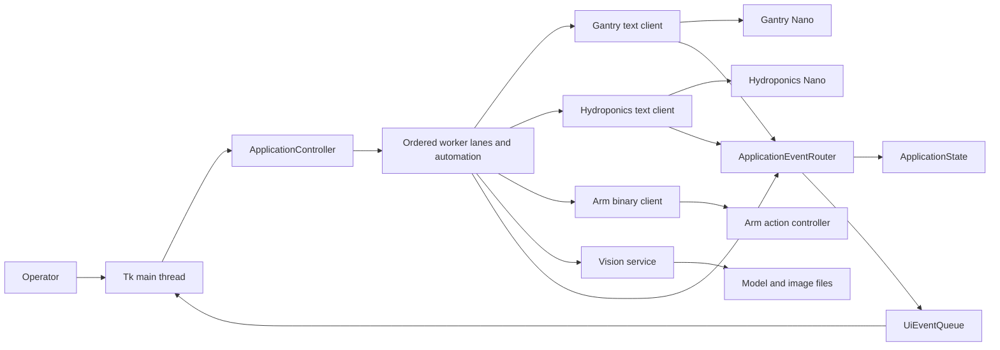

# System and code map

> November 2026 update: this is a detailed source reference. Start with the [current handbook](PROGRAMMING-HANDBOOK.html). The [owner's successful prototype report](reference/prototype-test-confirmation.html) covers the software branch and both updated Nano versions. The [Hiwonder chapter](09-hiwonder-arm-controller.html) supplies the now-confirmed controller and PC tool, official loading route and development references; the [report and asset note](10-reference-context-and-assets.html) adds subsequent report/dataset evidence. Original dates below identify the earlier review session, not a new deployment test.

This is a programming map of the **refactored code at the handover baseline**. The source demonstrates implemented control flow; deployed software identity and physical outcomes are separate evidence. Read [the index](README.html) for scope and [08](08-evidence-and-change-record.html) for the source commit and evidence labels.

## Ownership and communication

| Software endpoint | Owns | Receives/produces | Does not own |
|---|---|---|---|
| Raspberry Pi | Tkinter interface, camera/model inference, image files, application state, plant workflows | Operator actions, Nano text records; sends Nano commands and arm frames | Nano sensor acquisition, relay/motor GPIO |
| Gantry Nano | Stepper motion, homing/endstops, measured grid, motor enable state, inactivity behavior | 9600-baud newline commands; motion/diagnostic text | GUI, vision, hydroponics, arm groups |
| Hydroponics Nano | Sensor conversions, RTC lighting, manual/automatic dose timers, outputs | 9600-baud newline commands; periodic `STAT` records | Camera/plant classification, gantry movement |
| Arm action controller | Stored action-group execution | Pi native-UART binary frames | Nano coordination or Pi completion acknowledgements |

The simulation composition replaces the four providers with in-memory implementations. It exercises the same services and GUI event boundary, but is not a timing-accurate firmware emulator.

## Artifact classification

| Repository artifact | Classification and use |
|---|---|
| [structured Pi directory](../../source%20code/Raspberry%20Pi/GUI/refactored) | Primary handover implementation; explicit startup, services, providers, simulation, tests |
| [gantry_main_refactored](../../source%20code/gantry_main_refactored) | Parallel gantry implementation; includes existing intentional homing/fault differences |
| [NFT_Hydroponics_refactored](../../source%20code/NFT_Hydroponics_refactored) | Parallel hydroponics implementation; extracted config/controller |
| GTW_GUIv2.py | Preserved legacy operator entry point; current source also contains later changes than the July audit |
| ServoControl.py | Legacy arm protocol library; opens UART at import, so read as text only on laptop |
| gantry_main | Authoritative gantry source reference: sketch plus `GantryController.h/.cpp` |
| timestamped hydroponics sketch | Authoritative hydroponics source reference |
| older hydroponics sketch | Historical, different command/status format; not the current baseline |
| arduino_gui.py | Historical Pi prototype; not composed by refactored `app.py` |
| ECcalibration.ino, pHcalibration.ino | Calibration utilities; their constants/pins do not establish active calibration provenance |
| ClockModule, LightStatus | RTC/light test utilities; not current controller entry points |
| Gantry System, IDP | Historical motion/servo experiments; preserve for traceability |
| [Arm Action File](../../source%20code/Arm%20Action%20File) | Twelve binary deployment assets; exact installed file-to-group mapping unresolved |
| `Raspberry Pi/GUI/*.pt`, `*.onnx` | Nine model assets; active source selects `bestv5.pt`; alternatives are not approved substitutes |
| [GUI icon](../../source%20code/Raspberry%20Pi/GUI/assets/growtech-wall-icon.png) | Tracked visual asset; its presence is not evidence that every entry point loads it |
| [requirements-dev.txt](../../source%20code/requirements-dev.txt) | Intentionally no third-party requirements for headless tests |
| [requirements-pi.txt](../../source%20code/requirements-pi.txt) | Proposed direct package pins from captured Pi environment; not a reproduced ARM lock file |
| docs and .gitignore | Evidence/operations records and runtime-artifact exclusions |

Historical `IDP` material includes `Gantry_Dual_Y_axis_Test_Code`, `intervalxyyIDP`, `intervalxyyIDP_withDoubleHoming_20250331033052`, `sketch_mar16a_gantry`, `sketch_mar21a-gantry`, and `SerialServorecordMega` with `SerialServo.h`/`include.h`. `Gantry System/PatrolDoubleHoming` is another separate sketch. Neither filename nor age establishes which experimental artifact was flashed.

## Refactored Pi module navigation

Paths below are under [Raspberry Pi/GUI/refactored](../../source%20code/Raspberry%20Pi/GUI/refactored). Each layer has a specific maintenance boundary.

| Module | Main symbols and callers | Inputs, outputs, side effects, ownership |
|---|---|---|
| [app.py](../../source%20code/Raspberry%20Pi/GUI/refactored/app.py) | `main`, `parse_args`, `verify_hardware_platform`, `create_controller` | CLI mode → provider composition; `main` starts resources then Tk and guarantees shutdown in `finally` |
| [config/settings.py](../../source%20code/Raspberry%20Pi/GUI/refactored/config/settings.py) | `AppConfig`, `SerialEndpointConfig`, `VisionConfig`, `ArmActionConfig` | Frozen configuration used by factory/services; paths, units, fixed arm waits; no device opening |
| [domain/grid.py](../../source%20code/Raspberry%20Pi/GUI/refactored/domain/grid.py) | `position_for_plant`, `plant_for_xy`, `SNAKE_SEQUENCE` | Plant 1–24 ↔ Nano x 1–6/y 1–4; top-down GUI indices are zero-based |
| [domain/models.py](../../source%20code/Raspberry%20Pi/GUI/refactored/domain/models.py) | `Detection`, `VisionResult`, `HydroStatus` | Frozen values shared between providers, state and UI; pixel coordinates, labels, status fields |
| [comm/interfaces.py](../../source%20code/Raspberry%20Pi/GUI/refactored/comm/interfaces.py) | Provider `Protocol` contracts | `start`, `stop`, text `send`, arm group operations, plant `capture`; lets tests inject fakes |
| [comm/protocols.py](../../source%20code/Raspberry%20Pi/GUI/refactored/comm/protocols.py) | Command encoders and response parsers | Pure wire-format conversion/validation; no transport or acknowledgement generation |
| [comm/line_parser.py](../../source%20code/Raspberry%20Pi/GUI/refactored/comm/line_parser.py) | `BufferedLineParser` | Arbitrary bytes → complete newline records plus retained suffix; one instance per client |
| [comm/serial_transport.py](../../source%20code/Raspberry%20Pi/GUI/refactored/comm/serial_transport.py) | `SerialTransport` | Explicit lazy open/read/write/close, lock-protected lifecycle; Nano settle/buffer reset; real I/O only when invoked |
| [comm/clients.py](../../source%20code/Raspberry%20Pi/GUI/refactored/comm/clients.py) | `GantrySerialClient`, `HydroponicsSerialClient`, `ArmSerialClient` | Provider interfaces → wire writes; Nano reader threads parse and publish events; arm is write-only |
| [services/events.py](../../source%20code/Raspberry%20Pi/GUI/refactored/services/events.py) | `EventKind`, `AppEvent`, `UiEventQueue` | Read-only event envelopes and multi-producer queue; GUI drains at most 200 events per call by default |
| [services/state.py](../../source%20code/Raspberry%20Pi/GUI/refactored/services/state.py) | `ApplicationState`, `StateSnapshot`, `ApplicationEventRouter` | Condition-protected requested/reported state and generation counters; ordered event application/GUI publication |
| [services/worker_lane.py](../../source%20code/Raspberry%20Pi/GUI/refactored/services/worker_lane.py) | `OrderedWorkerLane` | FIFO callable jobs on a daemon thread; bounded join/cancel-pending lifecycle |
| [services/controller.py](../../source%20code/Raspberry%20Pi/GUI/refactored/services/controller.py) | `ApplicationController` | GUI facade; validates/submits jobs, orders motion/capture, owns reset epochs/provider lifecycle and teardown |
| [services/workflows.py](../../source%20code/Raspberry%20Pi/GUI/refactored/services/workflows.py) | `WorkflowService` | Coordinates text moves and arm/dose sequences; checks state/cancellation and assumed arm durations |
| [services/automation.py](../../source%20code/Raspberry%20Pi/GUI/refactored/services/automation.py) | `AutomationService` | Scan/full modes over snake order; publishes state transitions and vision outcomes; separate automation worker |
| [vision/logic.py](../../source%20code/Raspberry%20Pi/GUI/refactored/vision/logic.py) | `roi_bounds`, `select_best_detection`, `image_output_path` | Pure selection/path policy; synthetic inputs can be checked without model/camera dependencies |
| [vision/hardware.py](../../source%20code/Raspberry%20Pi/GUI/refactored/vision/hardware.py) | `HardwareVisionService` | Explicit camera/model initialization, full-frame inference/annotation/file writing; shutdown releases camera |
| [simulation/controllers.py](../../source%20code/Raspberry%20Pi/GUI/refactored/simulation/controllers.py) | Three `Mock*Controller` providers | In-memory commands/groups, source-shaped events; simulated dose timer, not real sensor/RTC acquisition |
| [simulation/vision.py](../../source%20code/Raspberry%20Pi/GUI/refactored/simulation/vision.py) | `MockVisionService` | Deterministic labels, capture history; no camera/model or production image file writes |
| [gui/main_window.py](../../source%20code/Raspberry%20Pi/GUI/refactored/gui/main_window.py) | `GrowTechWindow` | Main-thread Tk widgets/variables, callbacks, queue drain, images and dialogs; never delegate widgets to workers |
| [utils/errors.py](../../source%20code/Raspberry%20Pi/GUI/refactored/utils/errors.py), [logging_config.py](../../source%20code/Raspberry%20Pi/GUI/refactored/utils/logging_config.py) | `GrowTechError`, `HardwareUnavailableError`, `ProtocolError`, `configure_logging` | Expected failure types and console logging; not a durable controller event log |
| [tests](../../source%20code/Raspberry%20Pi/GUI/refactored/tests) and package `__init__.py` files | Standard-library tests/package boundaries | Mock/static evidence and import organization; not production entry points |

## Data and state invariants

`GridPosition` separates plant number, GUI row/column and Nano coordinates. Plant 1 is Nano `(1,1)` and GUI `(3,0)`; plant 24 is Nano `(6,4)` and GUI `(0,5)`. Do not interchange these numbering systems.

`ApplicationState` keeps requested coordinates separate from reported coordinates and a validity flag. A new request invalidates the cached position. Fresh matching accepted reports advance a local generation. These generations are not controller transaction IDs: the wire has no sequence number, so a late report with the same coordinates cannot be cryptographically or transactionally associated with a unique command.

`ApplicationEventRouter.publish()` holds a publication lock around state mutation and queue insertion. Thus concurrent readers/workers cannot update state in one order and enqueue the corresponding UI events in another. A rejected `START`/`POS` remains visible as an event with `accepted=false`; it must not repaint valid position.

Values in `HydroStatus` come from Nano conversions; the Pi does not recalibrate sensors. `VisionResult.image_path` may be absent in simulation. A `No detection` result does not alone prove successful inference: the hardware service also uses that outcome after a caught inference exception; see [05](05-vision-and-assets.html).

## Firmware module navigation

| Refactored path | Role |
|---|---|
| [gantry_main_refactored.ino](../../source%20code/gantry_main_refactored/gantry_main_refactored.ino) | Constructs shared motion/command objects; `setup` initializes and homes, `loop` checks inactivity then serial |
| [GantryConfig.h](../../source%20code/gantry_main_refactored/GantryConfig.h), [GantryConfig.cpp](../../source%20code/gantry_main_refactored/GantryConfig.cpp) | Pin/timing/step constants and measured grid arrays |
| [GantryMotion.h](../../source%20code/gantry_main_refactored/GantryMotion.h), [GantryMotion.cpp](../../source%20code/gantry_main_refactored/GantryMotion.cpp) | Driver/stepper ownership, blocking motion/homing, bounds, fault behavior |
| [GantryCommandProcessor.h](../../source%20code/gantry_main_refactored/GantryCommandProcessor.h), [GantryCommandProcessor.cpp](../../source%20code/gantry_main_refactored/GantryCommandProcessor.cpp) | Parsing, grid state/snake progression/patrol, command/timeout coordination |
| [NFT_Hydroponics_refactored.ino](../../source%20code/NFT_Hydroponics_refactored/NFT_Hydroponics_refactored.ino) | Thin `setup`/`loop` delegation to one controller |
| [HydroponicsConfig.h](../../source%20code/NFT_Hydroponics_refactored/HydroponicsConfig.h) | Relay/sensor/calibration/schedule/timing defaults |
| [HydroponicsController.h](../../source%20code/NFT_Hydroponics_refactored/HydroponicsController.h), [HydroponicsController.cpp](../../source%20code/NFT_Hydroponics_refactored/HydroponicsController.cpp) | RTC, acquisition/conversion, parsing, lighting, doses, `STAT` emission |

See [04](04-controller-firmware.html) for algorithms and existing intentional gantry differences. Software constants document the code's configuration; they are not a wiring diagram or measured physical calibration.

## Maintenance boundary

Change pure domain/protocol policy through synthetic fixtures first. Change provider lifecycle through injected transports/cameras. Change GUI behavior through queue events and fake widgets. Firmware and workflow changes that affect physical execution require the separately recorded validation gates in [the deployment plan](reference/refactored-deployment-and-validation-plan.html). Preserve the legacy entry points and assets until those gates pass.
