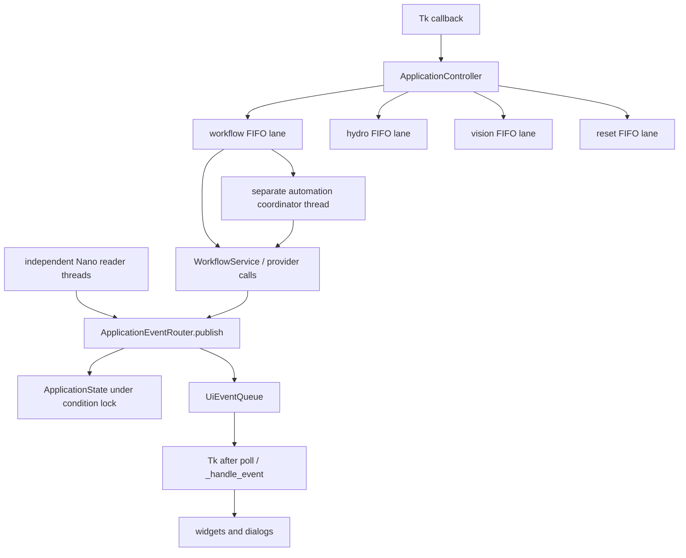
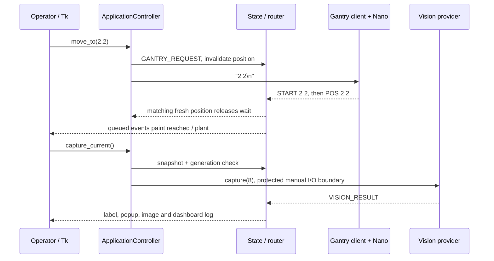

# Raspberry Pi application programming passdown

> November 2026 update: this is a detailed source reference. Start with the [current handbook](PROGRAMMING-HANDBOOK.html). The [owner's successful prototype report](reference/prototype-test-confirmation.html) covers the software branch and both updated Nano versions. The [Hiwonder chapter](09-hiwonder-arm-controller.html) supplies the now-confirmed controller and PC tool, official loading route and development references; the [report and asset note](10-reference-context-and-assets.html) adds subsequent report/dataset evidence. Original dates below identify the earlier review session, not a new deployment test.

Handover date: **2026-10-09**. Source baseline: `f6d8c6003382ca38fc7969202015d7ee22dfce84`, branch `refactor/gui-architecture`. This document focuses on the **parallel structured Pi application** and compares the preserved legacy entry point where the comparison affects maintenance. It records source behavior and existing desk evidence. It does not establish deployment or hardware validation of the refactor.

Read [the package index](README.html), [system/code map](01-system-and-code-map.html), [communications](03-communications.html), and [vision/assets](05-vision-and-assets.html) alongside this document. The current deployed operator contract remains manual `GTW_GUIv2.py` startup in [the Pi deployment manifest](reference/pi-deployment-manifest.html). Repository presence of `refactored/app.py` does not replace that contract.

## 1. Where to start in the refactor

The application separates interface widgets, coordination, state, communication, and providers. A **provider** implements a controller or vision interface; it can be a real-device implementation or an in-memory simulation. A **worker lane** is one first-in, first-out queue processed by a daemon thread, so its submitted jobs run in order. Daemon ownership permits process exit even when a third-party operation remains stuck; it does not cancel physical action.

| Module / main symbols | Purpose, callers, input and result | State and side effects |
|---|---|---|
| [app.py](../../source%20code/Raspberry%20Pi/GUI/refactored/app.py): `main`, `parse_args`, `verify_hardware_platform`, `create_controller` | Compose runtime, start providers, construct the window, run Tk, and shut down in `finally`. `--simulate` chooses mocks; `--verbose` changes logging. Platform rejection returns exit code 2. | Importing defines code only. Creating the controller constructs lane threads; explicit `start()` opens providers. |
| [config/settings.py](../../source%20code/Raspberry%20Pi/GUI/refactored/config/settings.py): `AppConfig`, `SerialEndpointConfig`, `VisionConfig`, `ArmActionConfig` | Immutable source-derived defaults for ports, model/camera, action durations, rack, pesticide amount and GUI polling. | No automatic configuration-file loader or GUI persistence. Defaults are passed into each instance. |
| [services/controller.py](../../source%20code/Raspberry%20Pi/GUI/refactored/services/controller.py): `ApplicationController` | GUI-facing facade. Validates, submits jobs, coordinates reset/capture, reports errors, owns startup/shutdown. | Owns providers, four lanes, lifecycle/admission/I/O locks, shutdown event and serial reset epoch. |
| [services/worker_lane.py](../../source%20code/Raspberry%20Pi/GUI/refactored/services/worker_lane.py): `OrderedWorkerLane` | Accept, execute, close and join a queue. The controller wraps ordinary jobs to convert exceptions into events. | Starts one daemon thread per instance. `close(cancel_pending=True)` drops queued work; the executing callable must return or observe cancellation. |
| [services/state.py](../../source%20code/Raspberry%20Pi/GUI/refactored/services/state.py): `ApplicationState`, `StateSnapshot`, `ApplicationEventRouter` | Thread-safe state, immutable snapshots, fresh-report waits, and ordered state/event publication. | Owns requested command/target, cached position and validity, report counters, latest hydro/vision data, automation state/history. No widgets. |
| [services/events.py](../../source%20code/Raspberry%20Pi/GUI/refactored/services/events.py): `AppEvent`, `EventKind`, `UiEventQueue` | Immutable event envelopes and a multi-producer GUI queue. | `drain()` removes at most 200 events without blocking. Payload objects are treated as read-only. |
| [services/automation.py](../../source%20code/Raspberry%20Pi/GUI/refactored/services/automation.py): `AutomationService` | One scan/full coordinator thread, state transitions and Stop handling. | Owns its stop event and thread/start lock. Uses fresh home/POS state, vision results and workflow service. |
| [services/workflows.py](../../source%20code/Raspberry%20Pi/GUI/refactored/services/workflows.py): `WorkflowService` | Harvest, transplant, pesticide and arm sequence coordination. | Sends controller commands, waits for accepted POS, uses assumed arm durations. No Tk access. |
| [gui/main_window.py](../../source%20code/Raspberry%20Pi/GUI/refactored/gui/main_window.py): `GrowTechWindow` | Constructs four tabs and popups; dispatches callbacks to controller; drains events. | Sole widget/Tk-variable owner. Remembers optimistic toggles, manual-dose warning times and GUI operation-lock state. |
| [comm/clients.py](../../source%20code/Raspberry%20Pi/GUI/refactored/comm/clients.py): `GantrySerialClient`, `HydroponicsSerialClient`, `ArmSerialClient` | Parse buffered Nano records into events and send text or binary frames. | Independent Nano reader threads; arm is write-only. See [communications](03-communications.html). |
| [domain/grid.py](../../source%20code/Raspberry%20Pi/GUI/refactored/domain/grid.py), [domain/models.py](../../source%20code/Raspberry%20Pi/GUI/refactored/domain/models.py) | Plant/coordinate mapping and transport-independent `HydroStatus`, `Detection`, `VisionResult`. | Grid coordinates are column/row indexes, not millimetres. Sensor conversions remain Nano-owned. |
| [vision/hardware.py](../../source%20code/Raspberry%20Pi/GUI/refactored/vision/hardware.py), [simulation/controllers.py](../../source%20code/Raspberry%20Pi/GUI/refactored/simulation/controllers.py), [simulation/vision.py](../../source%20code/Raspberry%20Pi/GUI/refactored/simulation/vision.py) | Selected real or mock providers behind [comm/interfaces.py](../../source%20code/Raspberry%20Pi/GUI/refactored/comm/interfaces.py). | Hardware opens model/camera/serial only at explicit start. Simulation has command histories, deterministic results, and timed dose-indicator events. |

## 2. Import, composition, startup and shutdown

`app.py` imports configuration, errors and logging helpers. It does not import `GTW_GUIv2.py` or `ServoControl.py`. In `main()` the mode is parsed before `create_controller()` chooses providers:

1. Construct `ApplicationState`, `UiEventQueue` and `ApplicationEventRouter`.
2. In simulation, import only mock provider modules. In hardware mode, first require Linux, `aarch64`, and a device-tree model containing `raspberry pi`; an unverified host is rejected before hardware-provider imports. This guard identifies a platform class, not the particular approved Pi deployment.
3. Construct providers, then `ApplicationController`. Its constructor creates workflow, hydro, vision and reset lane threads, plus workflow/automation services. Simulation injects a no-op sleeper into workflow/action and post-capture waits; it is not a physical timing simulation.
4. `ApplicationController.start()` starts **vision → arm → gantry → hydroponics**. Vision loads the model and opens the camera; arm opens the UART; both Nano transports open with their configured two-second settle and input/output-buffer resets. Opening a Nano port can reset/home the physical controller; no startup was performed in this handover.
5. Individual provider failures are caught. Offline `CONNECTION` and `ERROR` events are queued and the remaining providers are attempted, allowing an offline-capable GUI. `_started` records that the attempt completed, not that all endpoints work. Failures collected before Tk construction are displayed when its queue is drained.
6. Construct `GrowTechWindow` on the main thread, create variables/widgets and schedule `_drain_events()` every 50 ms by default. `run()` enters `root.mainloop()`.
7. Window `_close()` calls `controller.shutdown()` before destroying Tk. The enclosing `main()` calls shutdown again in `finally`; shutdown is designed to be repeatable.

Shutdown rejects new jobs, sets global job cancellation, wakes state waits, requests automation Stop, closes lanes while discarding pending work, and begins provider closes on daemon threads. It shares a two-second join/cleanup deadline across automation, lanes and provider-close completion. A stuck call is logged and may remain on a daemon thread. **Arm provider `stop()` closes its transport; shutdown does not call `stop_group()` or transmit the arm stop frame.** Controller/arm activity already sent may continue, and hydroponics autonomous behavior is Nano-owned. Bounded process cleanup is not a safe-actuator transaction.

The legacy program executes model loading, camera creation, arm import/UART open, Nano serial opens, Tk construction, reader start and `mainloop()` at module top level. It has no import-safe composition boundary. Its `on_closing()` only releases the camera and destroys Tk. Never import it or ServoControl.py for a desk test.

## 3. Threads, queues, locks and cancellation ownership

| Boundary | What it guarantees | What it does not guarantee |
|---|---|---|
| Per-lane FIFO | Earlier jobs in the same lane execute first. Grid/Next/Home jobs hold workflow progress until their associated report wait finishes. | No total order across hydro, vision, reset and automation threads. Relative movement has no POS fence. |
| Transport write lock | One frame/line's payload bytes remain together across writers. | No transaction ID, action reservation, acknowledgement correlation or physical completion. |
| Router publish lock | Apply state and queue the matching event as one ordered publication across producers. | Tk displays later, after a poll; state can be ahead of widgets. Queue size is not capped. |
| State condition lock | Snapshots and mutations are consistent; new reports notify waiters. | A source-accepted `POS` is still protocol evidence, not independently measured physical position. |
| `_serial_admission`, epoch lock | Reset blocks new endpoint jobs and invalidates previously accepted job epochs. Epoch is a generation number distinguishing pre-reset work from current work. | Does not retract bytes already sent or directly stop motors/pumps. |
| `_gantry_capture_io` and workflow-to-vision completion event | Manual move/capture ordering prevents a later manual write from overlapping an accepted manual capture. Capture rechecks position validity/generation after acquiring the lock. | No general hardware interlock; automation owns its separate sequential capture path. |
| Per-provider lifecycle lock | Serialize that provider's start/stop; unrelated providers can close independently. | Cannot force a blocked provider call to return. |
| Automation `_stop` | Releases its home/POS waits and 100-ms sleep slices; stages check before issuing subsequent work. | Cannot interrupt model inference, serial writes, blocking Nano motion, or an arm group already sent. |
| Controller `_job_cancel` / reset epoch | Cancels manual waits and queued work during shutdown/reset. | Manual workflow has no ordinary Auto-button Stop; cancellation can make a sequence return without finishing its intended physical action. |

`GrowTechWindow._assert_main_thread()` checks event handling/run/close thread ownership. Workers never own widgets. This differs from the legacy workers, which read button colours/Tk variables and update dialogs/widgets directly.

## 4. Requested position, reported position and grid numbering

The visible grid is four rows by six columns, with the top display row showing plants 19–24 and the bottom row 1–6. `position_for_plant()` maps display column `c` to Nano `x=c+1` and display row `r` to Nano `y=4-r`. Plant 1 is `(1,1)`; plant 6 is `(6,1)`; plant 24 is `(6,4)`. The gantry firmware owns conversion to measured motor steps.

In `ApplicationState`:

- `requested_command`, `requested_x` and `requested_y` describe intended work. `GANTRY_REQUEST` invalidates position **before** sending. The cached `current_x/current_y` can remain present while `position_valid=False`; always check validity.
- `GANTRY_START` invalidates position and binds or matches a valid target. `G`/`P` can learn their target from START. Mismatched/out-of-range records remain raw-log-visible and carry `accepted=False` to the GUI.
- Accepted `GANTRY_POSITION` sets position valid, advances `position_generation` and clears the request. With a concrete target, it must match. With no pending request an unsolicited in-range POS may be accepted; this is not an authenticated transaction model.
- Disable, timeout, offline, home and reset invalidate position. Their coordinate-less blocker prevents a delayed generic POS from restoring validity until replaced by an appropriate new request. Home completion preserves a pending explicit request when needed for a re-enable/home/move sequence.
- `wait_for_position()` requires an accepted matching coordinate with a newer generation than the captured pre-write counter. `wait_for_any_position()` supports Next. Both poll the condition at 100-ms intervals and have **no completion deadline**.
- `home_generation` advances on parsed `Homing complete.`. `wait_for_home()` accepts a newer home event, or an explicitly associated fresh `POS 1 1` compatibility path. A home event alone does **not** establish a valid plant coordinate; a subsequent grid move is still required for capture/harvest/transplant.

A report-generation counter prevents a previously cached coordinate alone from satisfying a new wait. It cannot disambiguate a very late same-coordinate report because the wire protocol has no request ID. See [communications](03-communications.html) for framing and limits.

The legacy instead combines selected/requested/reported position in `current_target` and button colours. Its initially selected plant 1 is not based on a received POS. Scan-only's initial home wait can pass immediately after `mark_target_moving(1,1)` sets `(3,0)`; full-auto's reached-colour wait can hang because home emits no POS.

## 5. Tabs and every operator control

The builder methods and event dispatcher are in [GrowTechWindow](../../source%20code/Raspberry%20Pi/GUI/refactored/gui/main_window.py). The four tabs retain the legacy operator landmarks, with differences below recorded explicitly.

| Tab / control | Handler and software action | Feedback / completion assumption |
|---|---|---|
| Dashboard: endpoint boxes | `_handle_event(CONNECTION)` → `_set_online()`; hydro endpoint also drives Grow Light online box. | Open/provider availability, not actuator health. |
| Dashboard: water/EC/pH, latest image/detection/plant, log | `_update_hydro`, `_show_vision_result`, accepted GANTRY_POSITION, `_log_message`. | Latest queued report/result; no persistent event-history file. Water display clamps Nano percentage to 0–100. |
| Dashboard: **Reset Devices** | `ApplicationController.reset_serial()`; method name is historical. | Resets camera/vision and both Nano connections, leaves arm UART alone; endpoint errors plus completion notice. |
| Gantry & Arm: Home | `send_gantry(gantry_home_command())` → `0 0`. | Waits for fresh home completion or compatible home POS; homed alone is not plant-selected. |
| Up / Down / Left / Right | `gantry_relative_command()` → `U` / `D` / `L` / `R`. | Source firmware requests 10-mm relative movement. No POS response; position is invalidated and job returns after write. |
| Next | `send_gantry("G")`. | Waits for any fresh accepted in-range POS before a later workflow-lane job runs. |
| Disable | `send_gantry("O")`. | Firmware's home-dual-Y-then-disable operation. No immediate-stop guarantee and no wait in facade. |
| 24 Gantry grid buttons | `_create_grid_position_button()` → `move_to(x,y)` → grid command. | START paints moving/orange; accepted POS paints reached/green with black selection border. |
| Harvest / Transplant / Pesticide | Controller submits an exclusive `WorkflowService` job. | OPERATION_STATE disables registered controls while running; see detailed sequences. |
| Capture | `capture_current()` with workflow-to-vision fence. | Requires valid reported grid position; capture worker emits VISION_RESULT, or ERROR. |
| Auto / Stop | `_choose_auto_mode()` shows separate Scan Only and Full Auto buttons, then `_start_automation()`. During automation it requests Stop. | Automation events drive button label and control disablement; Stop is orchestration cancellation. |
| Hydroponic: Dose A+B / Acid | `_ask_dose("FERT"/"ACID")` → `_confirm_dose()` → `controller.dose()`. | Starts at 5 mL, adjusts in 5-mL steps, minimum 5. Warning if same-kind GUI request was within 30 minutes; operator may override. |
| Water / Light toggles | `_toggle_water` / `_toggle_light` → `set_water` / `set_light`. | Button immediately shows requested state; later STAT reconciles reported state. |
| EC target Set | `_show_ec_target_popup()` → `set_ec_target()`. | Default GUI 1500.0 µS/cm; increments 100, minimum 0, one-decimal command. This display default is not proof of the Nano target. |
| pH target Set | `_show_ph_target_popup()` → `set_ph_target()`. | GUI default 6.50; increments 0.5, minimum 0, two-decimal command. |
| Auto dose Set | `_show_auto_dose_popup()` → `set_dose_time()`. | GUI default 5 mL; increments 5, minimum 0; sends legacy DOSE_TIME volume-derived duration setting. |
| Light schedule Set | `_show_light_schedule_popup()` → `set_light_schedule()`. | Defaults 07/19; arrows wrap 0–23; two ordered commands on hydro lane. |
| A/B/Acid/Water/Light indicators and serial boxes | `_update_hydro`, HYDRO_RAW, and hydro `LOG` beginning `Sent: `. | A and B share fertilizer state; no pesticide indicator. Raw received records remain visible. Sent log means client write returned. |
| Vision: 24 numbered buttons and labels | Position buttons call `move_to()`; VISION_RESULT updates label for `result.plant`. | Buttons move only. Capture is on Gantry & Arm; labels retain latest per-plant result in this window. |

Registered `_manual_buttons` are Reset Devices, Gantry/arm actions and both tabs' position buttons. Hydroponic controls/settings are not registered and remain available through their independent lane during these workflows. Auto remains available during automation for Stop, but is disabled during an exclusive manual operation. Simulation delays visible operation-lock release by 400 ms so immediate mocks can be inspected; hardware mode has no added visibility delay.

GUI setting labels change after input validation/submission, before any controller acknowledgement; current firmware does not return settings in STAT. `_last_dose` records request time even if a queued write later fails, resets when the GUI restarts, and is not a chemical interlock or the Nano's automatic-dose timer.

## 6. Manual movement and capture call flow

For an absolute grid click, `move_to()` creates a range-checked `<x> <y>` command. `send_gantry()` admits it with the current reset epoch, submits to the workflow lane, rejects overlap with active automation, and acquires `_gantry_capture_io`. It publishes GANTRY_REQUEST, records generation counters and writes the line. Outside the I/O lock it waits for accepted fresh POS. A lost report can hold the workflow lane indefinitely until reset/shutdown; hydro lane and reset remain separate.

For Capture, admission first checks valid position. When its workflow-lane turn arrives, it snapshots again, derives the plant number, and submits a vision-lane job. Under `_gantry_capture_io` the capture rechecks validity, generation and coordinates, then calls `VisionService.capture()`. The workflow lane waits on a completion event, so a subsequent manual move remains behind capture even though model work runs in the vision lane. Capture errors are converted to ERROR by the submit wrapper; its `finally` still releases the ordering fence. The vision backend does camera/inference/save work; `_show_vision_result()` on Tk creates the popup and dashboard image. See [vision/assets](05-vision-and-assets.html).

Relative moves deliberately return after write because current firmware emits no POS for them. Capture/harvest/transplant remain blocked until a fresh grid selection establishes validity. This is distinct from a deadline or physical motion-complete check.

## 7. Scan-only and full-auto workflows

`start_automation(mode)` is queued on the workflow lane so earlier manual movement/capture completes first. `AutomationService.start()` accepts only `scan` or `full`, protects clear-and-launch with its lock, rejects a second running automation, then starts its own daemon coordinator. Manual workflow-lane jobs subsequently reject while automation is running.

`AutomationService._run()`:

1. Publish `homing`; snapshot home and position generations; publish request and send `0 0`; wait for a new home completion/compatible home POS. This intentionally fixes the legacy home-handshake bug without changing Nano bytes.
2. Visit snake order **1–6 → 12–7 → 13–18 → 24–19**. For each plant publish `moving`, record position generation, publish/write grid command and wait for a fresh accepted matching POS.
3. Publish `capturing`; call vision synchronously on this automation thread; publish VISION_RESULT with auto-close popup flag. No worker reads a GUI label to decide the next action.
4. **Scan-only:** perform no arm or dose operation; preserve a one-second inter-pot gap in 100-ms cancellation slices.
5. **Full-auto:** publish `acting`; dispatch by the case-sensitive label rules below, then preserve a 0.1-second gap.
6. Publish `complete`, `stopped` or `failed`. Exceptions publish ERROR and `failed`; `finally` clears the owned thread handle.

| Result label test, in precedence order | Full-auto action |
|---|---|
| Exactly `No detection`, or contains `Immatured` | Arm group 5 and its assumed wait. |
| Contains `Matured` | Harvest; then transplant if Stop was not requested. |
| Any other label | Pesticide. This broad fallback is source policy, not proof that every such label represents disease. |

Stop sets the coordinator stop event, publishes `stopping` while active and releases its own state/sleep waits. In-flight capture/inference can still return a VISION_RESULT before the next stop check. No emergency-stop transaction is sent. `complete` means the Pi loop and assumed waits returned; it does not certify arm/pump completion.

## 8. Harvest, transplant, pesticide and arm completion

These functions are in [WorkflowService](../../source%20code/Raspberry%20Pi/GUI/refactored/services/workflows.py); GUI wrappers and exclusivity are in [ApplicationController](../../source%20code/Raspberry%20Pi/GUI/refactored/services/controller.py). Group descriptions reflect source intention; the `.rob`-to-board-slot mapping and physical poses remain unverified.

| Group | Source meaning | Fixed assumed duration |
|---:|---|---:|
| 1 | Harvest pickup | 4 s |
| 2 | Rotate/store in basket | 4 s |
| 3 | Pick seedling from rack | 5 s |
| 4 | Plant seedling | 7 s |
| 5 | Idle/camera pose | 1 s |
| 6 | Pesticide spray arm action | 10 s |

`run_arm_group_interruptibly()` checks cancellation, writes group with repeat count one and waits in slices up to 0.1 s. It never reads an arm completion acknowledgement. An expected `GrowTechError` publishes a warning and returns **True** without the action-duration wait so the containing sequence continues. This True means permission for coordinator progress, not successful physical action. Other exception types propagate. The non-interruptible `run_arm_group()` helper sends/sleeps directly but the current GUI/automation facade uses the interruptible helper.

**Harvest**, from a valid current `(x,y)`:

1. Require valid reported position; group 1; wait 0.5 s.
2. If `x==1`, move to `(2,y)` and wait for fresh POS; group 2; move back to `(1,y)` and wait. At other columns, group 2 without that temporary move.
3. Wait 1.0 s; group 5; emit ARM_STATE Idle.

**Transplant**, saving original coordinate:

1. Require valid reported position. Move to rack plant 6, `(6,1)`, and wait for fresh POS.
2. Group 3; move back to saved original coordinate and wait for fresh POS.
3. Group 4; wait 0.5 s; group 5; emit Idle.

**Pesticide**:

1. Check cancellation; send `DOSE:PEST:11` through Hydroponics provider.
2. Group 6; wait 0.5 s; group 5; emit Idle.

The current refactor's pesticide wrapper/service has **no required-position or same-coordinate refresh check**. Its arm helper also has no gantry reconfirmation before groups. This differs from the current legacy code, whose `refresh_gantry_position_before_arm()` serializes a re-send of the last green grid coordinate, requires a matching new POS within 45 seconds before each group, and precedes pesticide dosing. Do not assume that later legacy addition was ported into the parallel application.

The pesticide write is not a pump-start acknowledgement. Firmware uses its global dose-time setting rather than the PEST argument to determine duration; see [communications](03-communications.html) and [controller firmware](04-controller-firmware.html). Fixed arm waits do not establish dose/action alignment.

A failed Hydroponics write raises before group 6 and fails the operation. A skipped arm group can allow subsequent gantry/dose steps. A cancelled manual workflow normally returns `None`; `_run_exclusive_workflow()` then emits outcome `complete` because no exception was raised. Treat that GUI outcome as a software-return indication. Position waits themselves remain deadline-free. Maintenance must preserve or deliberately characterize each of these policies before changing them.

## 9. One worked end-to-end example: click plant 8, then Capture

This is a **source-derived example**, not a captured physical transcript. Plant 8 maps to Nano `(2,2)` and GUI display `(row=2,column=1)`.

1. Either tab's plant 8 button invokes `move_to(2,2)`. `gantry_grid_command()` returns `2 2`; `line_command()` encodes the newline-terminated bytes.
2. Firmware command dispatch parses column/row and calls its grid-position move. It emits `START 2 2`, moves toward its measured step-array targets, then emits `POS 2 2`. See [firmware](04-controller-firmware.html) for both baseline and parallel gantry implementations; neither text alone proves physical alignment.
3. `GantrySerialClient` feeds complete lines into `parse_gantry_report()`, publishes raw plus structured events, and router/state accepts the matching report. POS increments the counter and clears the request. The workflow-lane wait is released by state even before Tk finishes displaying the queue.
4. GUI `_handle_event()` displays only accepted structured motion events, marks selection in both grids, updates plant #8 and logs reached state.
5. Capture selects the latest valid `(2,2)` when its ordered job runs, captures plant 8, and emits `VisionResult(plant=8, ...)`. Hardware saves the annotated image at the configured plant-8 path; simulation supplies a mock result and writes no production image.
6. GUI result handling updates the plant-8 Vision label, last detection/image and popup. Manual Capture performs no harvest/dose action; only full-auto dispatch uses the result to choose those actions.

## 10. Reset/reconnect and failure routes

`reset_serial()` now implements **Reset Devices** despite its method name. It immediately marks an exclusive operation, advances the serial epoch, invalidates gantry position, wakes waiters and enqueues ordered workflow/hydro/vision barriers. A barrier is a no-op marker showing that previously queued work on that lane has returned. New endpoint requests are rejected until reset finishes.

The reset lane requests automation Stop, starts Nano closes on daemon threads and waits for close/automation/barrier completion against one two-second **quiescence deadline**. It closes/restarts vision only after automation/workflow/vision work has quiesced; otherwise camera remains unchanged and an error is published. A Nano whose prior work/close is not ready remains offline rather than reopening beside that work. Provider-specific lifecycle locks serialize each reopen against shutdown. Arm is not reset.

Ready provider `start()` calls occur after those readiness checks and include model reload/camera open and Nano settling. **Total reset duration is not limited to two seconds**; restart calls have no overall deadline. The completion notice says `Camera and serial connections have been reset.` even when separate errors/result log describe offline or unchanged endpoints. Read the per-endpoint messages, not the notice alone.

| Symptom / condition | Relevant source and actual behavior | Safe desk investigation |
|---|---|---|
| Startup endpoint offline | `start()` catches per-provider exception, publishes connection false and ERROR; GUI stays usable. | Inject failing providers and inspect event order; no live reopen. |
| Gantry write/read failure | Client marks offline; reader additionally emits ERROR and terminates. Invalid position blocks capture/harvest/transplant; existing generation wait still needs cancellation if no matching report arrives. | Fake transport failure and state-wait/cancellation tests. |
| No POS / home text missing | Fresh-report wait has no deadline and can retain its lane/coordinator. | Feed prerecorded missing/wrong/late records, then exercise reset or Stop. |
| Malformed status/report | Raw event remains visible; parser reports malformed structured record; state is not updated from it. | Feed fragments, combined lines, nonnumeric/nonbinary fields. |
| Model/camera/inference error | Model/camera startup and final read/save failures propagate to facade/automation ERROR. Capture catches inference/box-iteration exceptions, logs them and may still save/select partial candidates or `No detection`, without entering failed. | Inject camera/model fakes; distinguish acquisition/startup errors from caught inference failures; see [05](05-vision-and-assets.html). |
| Arm unavailable | Expected GrowTechError becomes warning; skip group and continue policy. | [test_workflow_failures.py](../../source%20code/Raspberry%20Pi/GUI/refactored/tests/test_workflow_failures.py) checks that policy with fake endpoints; it is not a physical acceptance record. |
| Reset completed but endpoint offline | Quiescence/open failure logged separately; common completion notice is still emitted. | Inject stuck close/work and failing start; inspect results and connection events. |
| Hydro setting/toggle appears successful before device applies it | GUI feedback is optimistic/submission-based; no correlated ACK. | Inspect queued event/log/status sequences using mocks. |

Recovery, prerequisites and approved future deployment gates are maintained in [development/testing/recovery](06-development-testing-and-recovery.html), [deployment manifest](reference/pi-deployment-manifest.html), and [refactored validation plan](reference/refactored-deployment-and-validation-plan.html). Do not use hardware startup/reconnect as a laptop verification command.

## 11. Compatibility differences and evidence cautions

| Concern | Current legacy source | Current parallel refactor | Handover interpretation |
|---|---|---|---|
| Entry point/deployment | `GTW_GUIv2.py`, top-level initialization; manual startup evidence. | `app.py`, explicit provider composition; simulation/platform guard. | Refactor is a separate implementation, not established as deployed. |
| Home completion | Full-auto waits for reached colour/POS missing after home; scan can pass from requested state. | Accepts fresh homing text or associated fresh home POS. | Intentional desk-verified correction. |
| Tk threading / state | Worker accesses Tk; conflated target/button state, optimistic initial plant 1. | Widget-free services, main-thread queue, validity and generation model. | Intentional architectural difference; reports remain protocol-only evidence. |
| Serial reader | One shared reader; hydro arbitrary chunks and idle blocking read can delay gantry handling. | Independent buffered readers; idle reads avoid blocking. | Intentional framing/lifecycle correction. |
| Arm refresh | Matching POS refresh, 45-second gate, serialized before each group and before pesticide dose. | Absent in workflow/service wrappers. | Significant current-baseline compatibility gap. |
| Missing arm endpoint | Legacy group helper warns/returns False; harvest/transplant/pesticide generally return early on that result. | Interruptible helper warns/returns True and lets containing sequence continue. | Existing documents describe older compatibility intent; actual policies differ now. |
| Scan-only post-capture delay | Already checks Stop in 100-ms slices at this commit. | Also checks 100-ms slices. | Older phase statements that only the refactor adds responsiveness are stale. |
| Model fallback/error | Invalid ONNX fallback uses the `.pt` path; inference failure can leave no/current detection label. | Ultralytics `.pt` provider; inference exceptions are logged and can still produce a saved ordinary result, while startup/read/save failures propagate. | Backend/failure details require separate comparison; no model comparative run here. |
| Reset | Nano ports only, sleeps on Tk callback, unsynchronized reader. | Reset Devices covers vision and Nanos on separate lane with epochs/barriers; arm unchanged. | Later source change exceeds earlier Serial Reset descriptions. |
| Shutdown | Camera release and Tk destroy only. | Cancellation, lane close, provider closes, bounded joins. | Software cleanup difference; neither certifies actuator safe state. |
| Grid locking / Hydro controls | Legacy grid buttons are not added to its manual lock list; Hydro controls also remain active. | Both grids registered and disabled; Hydro controls remain separate. | Visible locking is expanded in refactor. |
| Vision image display | Pillow scales to maximum dimension 400; popup/dashboard built in capture worker. | Tk loads saved PNG, integer subsampling based on `max_dimension // 400`; UI thread owns popup. | Display scaling is not identical; e.g. 640-pixel image uses scale 1 and can exceed 400. |

The July audit/refactoring documents remain useful historical evidence but contain older phase descriptions. This handover uses current source for the differences above. Existing recorded Windows operator-confirmed simulation is desk evidence for the recorded revision and environment; it does not prove the later legacy additions are in the refactor or validate physical action.

For programming backlog and acceptance checks, continue with [maintenance/open issues](07-maintenance-and-open-issues.html). For inspected artifacts, comment-only validation and evidence limitations, see [evidence/change record](08-evidence-and-change-record.html).
