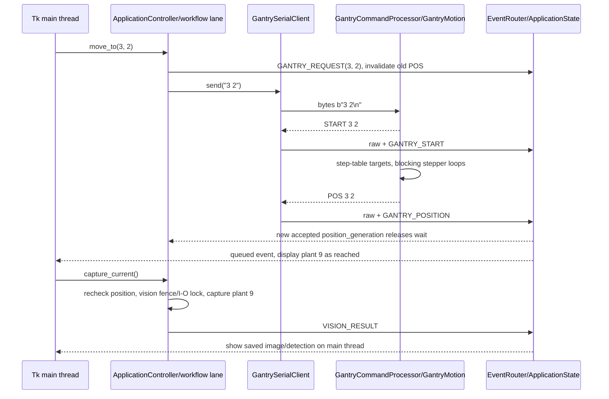

# Communications: structured clients and preserved wire contracts

> November 2026 update: this is a detailed source reference. Start with the [current handbook](PROGRAMMING-HANDBOOK.html). The [owner's successful prototype report](reference/prototype-test-confirmation.html) covers the software branch and both updated Nano versions. The [Hiwonder chapter](09-hiwonder-arm-controller.html) supplies the now-confirmed controller and PC tool, official loading route and development references; the [report and asset note](10-reference-context-and-assets.html) adds subsequent report/dataset evidence. Original dates below identify the earlier review session, not a new deployment test.

Prepared 2026-10-09 from source commit `f6d8c6003382ca38fc7969202015d7ee22dfce84` on `refactor/gui-architecture`. The structured implementation is the primary maintenance subject. Its protocol handling is **desk-verified future work**; repository presence does not establish deployment. The legacy application, current controller baselines and captured endpoint configuration provide the compatibility reference. All exchanges and hexadecimal examples below are **source-derived examples**, not captured serial traffic or evidence of physical completion.

Start with the [package index](README.html), [Pi application](02-pi-application.html) and existing [Pi-to-controller protocol baseline](reference/pi-nano-protocol.html). This chapter explains how the refactored APIs implement that baseline and identifies differences. Controller algorithms are covered in [controller firmware](04-controller-firmware.html); deployment identities belong to the [Pi deployment manifest](reference/pi-deployment-manifest.html).

## Endpoints and connection ownership

The Pi talks independently to three controllers. Neither Nano relays robotic-arm commands.

| Client | Default endpoint | Explicit source settings | Startup behavior |
|---|---|---|---|
| `GantrySerialClient` | `/dev/arduino_gantry` | 9600 baud; read timeout 1.0 s | Open; wait 2 s; discard input and output buffers; launch its reader |
| `HydroponicsSerialClient` | `/dev/arduino_hydroponic` | 9600 baud; read timeout `None` | Same 2 s settle and buffer reset; its own reader and line buffer |
| `ArmSerialClient` | `/dev/ttyAMA1` | 9600 baud; read timeout `None` | Open with no settle delay or buffer reset; write-only |

The defaults are in [config/settings.py](../../source%20code/Raspberry%20Pi/GUI/refactored/config/settings.py), not an editable external configuration file. Captured legacy resolution is Gantry to `/dev/ttyUSB1`, Hydroponics to `/dev/ttyUSB0`. These are USB-topology aliases; the recorded `/dev/arduino_roboticarm` alias is absent. Do not substitute it for the native UART. Other serial options are not explicitly specified by these sources, so a future reproducibility record must capture the actual library/default configuration.

Importing [serial_transport.py](../../source%20code/Raspberry%20Pi/GUI/refactored/comm/serial_transport.py) defines the adapter without importing pyserial or opening a port. `SerialTransport.open()` performs the dependency import and device access; on failure it closes a partially created handle and raises `HardwareUnavailableError`. `ApplicationController.start()` starts vision, arm, Gantry and Hydroponics in that order, reporting individual failures through events so the GUI can still operate offline. This differs from legacy import-time initialization.

`SerialTransport.write(payload)` holds a per-endpoint lock around one `handle.write`. It prevents simultaneous callers interleaving payloads, but provides no transaction, retry, duplicate suppression, controller reservation or correlated response. The returned write count is not checked. A successful `Sent: ...` log means the call returned, not that the controller accepted the command.

`read_available()` reads exactly the bytes reported by `in_waiting`, or returns empty bytes without calling `read` when idle. This keeps the Hydroponics reader from requesting a blocking byte under `timeout=None`. Each text client loops with a cancellable 10 ms wait; parse/read failures publish error and offline events and end that reader. There is no automatic reconnect. `stop()` requests reader termination, closes the handle, joins for up to 1 s and clears partial input; a bounded join is not proof a malfunctioning thread has exited. Reset coordination and bounded shutdown belong to `ApplicationController`, as explained in [02](02-pi-application.html).

Opening/reopening a Nano USB endpoint may reset the controller. Exact bridge behavior remains unverified; Gantry firmware homes at startup. The 2 s input-buffer reset can discard startup text. A serial reset therefore must not be described as a harmless status refresh.

## Text framing and parser boundaries

[protocols.py](../../source%20code/Raspberry%20Pi/GUI/refactored/comm/protocols.py) separates command construction and parsing from hardware. `line_command()` requires a nonempty command containing no CR or LF and returns UTF-8 bytes with one terminating LF (`0A`). For example, grid command `3 2` becomes `33 20 32 0A`. Built-in commands use ASCII characters, whose UTF-8 bytes are unchanged.

[BufferedLineParser.feed()](../../source%20code/Raspberry%20Pi/GUI/refactored/comm/line_parser.py) accepts arbitrary byte chunks. It retains incomplete suffixes, splits at LF, decodes UTF-8 with invalid bytes ignored, removes trailing CR/outer whitespace and omits blank records. Each Nano gets a separate parser. Firmware uses `Serial.println` for records; the Pi accepts CR before LF. A read boundary is never a message boundary.

For example, feeding `b"POS 3"` emits nothing. Feeding `b" 2\r\nSTART 4 2\nSTA"` next emits `POS 3 2` and `START 4 2`, retaining `b"STA"`. This is a synthetic framing illustration. The default buffer limit is 65,536 bytes, checked before complete lines are drained from the new chunk. Exceeding it clears the buffer and raises `ValueError`, which ends the client reader through its error path. There is no timeout for a partial line.

Both Arduino implementations call `readStringUntil('\n')` and trim the result. Neither baseline nor refactor explicitly sets a serial stream timeout. Do not confuse their inherited library timeout with the Pi read timeout, a homing timeout, or an operation-completion deadline. Board/core metadata is missing, so this task does not assign a verified numeric timeout to that inherited behavior.

Legacy Gantry input already accumulated complete lines. Legacy Hydroponics passed an entire arbitrary read chunk to `update_serial_output()` and could lose fragmented records or misinterpret combined records. Independent buffered framing in both structured clients is an intentional software correction.

## Gantry commands and interpretation

Coordinates are **1-based grid indices**, not millimetres: columns/X 1–6, rows/Y 1–4. The GUI has top-down row indices; `gui_row = 4 - y`, `gui_column = x - 1`. Plant number is `(y - 1) * 6 + x`. The firmware converts the indices using measured step tables; see [04](04-controller-firmware.html).

The wire grammar below is implemented by legacy `GantryController::processSerialCommand()` and refactored [GantryCommandProcessor::processSerialCommand()](../../source%20code/gantry_main_refactored/GantryCommandProcessor.cpp).

| Text before LF | Pi builder or use | Source behavior and completion evidence |
|---|---|---|
| `<col> <row>` | `gantry_grid_command(x, y)` validates 1–6/1–4 | Emits `START col row`, runs blocking movement, emits `POS col row`, then delays 200 ms |
| `0 0` | `gantry_home_command()` | Full homing and position zeroing; emits `Homing complete.`; **no grid `POS`** |
| `U`, `D` | `gantry_relative_command()` | Y +10/-10 mm; descriptive text; no `POS` |
| `L`, `R` | Same builder | X -10/+10 mm; descriptive text; no `POS` |
| `G` | Next button | Snake-grid next; duplicate `START` because next and movement each print it; then `POS` |
| `O` | Disable button | Homes dual Y before driver disable; emits `Motors disabled.` |
| `P` | Firmware patrol; outside normal Auto workflow | Visits the snake grid with duplicate `START`; checks serial only between blocking moves |
| `X` | Patrol termination only | Consumed by `patrolGrid()` at its checks; outside patrol it is an unknown single-letter command |

Single-letter comparisons tolerate case. Numeric parsing uses Arduino `String.toInt()` and first-space splitting, not strict Python integer validation. Thus malformed input is not uniformly rejected: substrings that convert to zero can reach the `0 0` home branch. Use the validated builders; do not reinterpret existing firmware parsing as strong input validation. Invalid in-range syntax can produce `Unknown single-letter command.`, `Invalid command format.` or `Error: Grid coordinates out of range.`.

When drivers are disabled, a nonempty command other than `O` first enables motors and homes all axes, then processes the command; even an eventual invalid command can trigger that prerequisite. The 60,000 ms inactivity check also homes all axes before disabling. It runs before command processing in the firmware loop. Normal motion/homing is blocking and cannot process a Pi Stop request mid-move. `POS` follows completion of source stepper loops; it is not independent physical-position measurement.

`parse_gantry_report()` returns a `GantryReport` retaining raw text:

| Record | Parsed meaning | `GantrySerialClient` event/result |
|---|---|---|
| Exactly `START <int> <int>` | `start` | Raw plus `GANTRY_START` |
| Exactly `POS <int> <int>` | `pos` | Raw plus `GANTRY_POSITION` |
| Exactly `Homing complete.` | `home_complete` | Raw plus `GANTRY_HOME_COMPLETE` |
| Prefix `TIMEOUT:` | `timeout` | Raw plus `GANTRY_TIMEOUT` |
| Contains `Motors disabled` | `disabled` | Raw plus `GANTRY_DISABLED` |
| Prefix `STATE` | `state` | Raw only: the client does not translate this kind to a state event, and current firmware does not emit it |
| Three-field START/POS with nonnumeric coordinates | `malformed` | Raw plus error |
| Other text, including `ERROR: ... Halting.` and other malformed lengths | `text` | Raw only |

The parser does not check coordinate range; `ApplicationState.apply()` does. Homing fault text is not a structured failed-move event, so a waiter can remain pending after a firmware halt. This is a documented limitation, not a fix in this handover.

## Worked exchange: select plant 9 and capture

This follows the **refactored** GUI through source processing. It illustrates the wire contract across the refactored Gantry firmware; the legacy controller uses corresponding logic. It is not a record of either firmware being flashed.



1. The selected button represents GUI row 2, column 2, Gantry `(3, 2)`, plant 9. `move_to()` validates coordinates and submits a workflow job; serial writes do not block the Tk callback.
2. Before writing, the controller publishes `GANTRY_REQUEST`, clearing `position_valid` and storing requested coordinates. It snapshots `position_generation` and sends one LF-terminated command under the Gantry/capture I/O lock.
3. Firmware refreshes its last-command time, updates its logical grid tracker, looks up `X_POSITIONS_STEPS[1][2]` and `Y_POSITIONS_STEPS[1]`, clamps targets and prints `START 3 2`. It runs stepper loops, prints `POS 3 2`, then performs its 200 ms settle delay. Pi acceptance of `POS` can therefore precede that firmware delay ending.
4. The reader frames bytes and parses each line. The event router applies state and queues the associated UI event under one publish lock. `START` invalidates a previously valid position; a matching in-range `POS` sets current coordinates, increments `position_generation` and clears the pending request. Mismatched reports remain visible raw with `accepted=False` and do not paint a reached cell.
5. `wait_for_position()` requires a newer generation, valid state and matching coordinates. It checks cancellation in 100 ms condition waits, with **no completion deadline**. A matching old reply already accepted before the request cannot satisfy this generation check. Without transaction IDs, a delayed reply for the same coordinate can still be ambiguous.
6. Every 50 ms by default, `GrowTechWindow._drain_events()` processes up to 200 queued events. `_handle_event()` paints the reached position and resolves plant 9. `capture_current()` fences earlier workflow movement, rechecks the reported position/generation and coordinates an injected vision provider; see [vision](05-vision-and-assets.html). There is no state derived from widget color in this path.

Homing is a distinct completion boundary: refactored `wait_for_home()` accepts a newer `Homing complete.` or newer accepted `POS 1 1` as a compatibility path. The former **does not establish a selected grid plant**, so capture remains blocked until a fresh grid `POS`. The legacy full-auto homing wait expected a reached `(1,1)` UI cell even though `0 0` emits no `POS`; its indefinite wait is corrected in the refactor without changing the firmware wire output.

## Hydroponics commands, units and status

Refactored firmware dispatch is in [HydroponicsController::processCommand()/processDoseCommand()](../../source%20code/NFT_Hydroponics_refactored/HydroponicsController.cpp). Its reference is the timestamped authoritative legacy firmware, not the historical root sketch. Both uppercase keys/values, split at the first colon and send no command acknowledgement.

| Text before LF | Builder/validation in `protocols.py` | Firmware behavior |
|---|---|---|
| `WATER_PUMP:ON` / `WATER_PUMP:OFF` | `hydro_water_command(bool)` | `ON` selects on; every other value selects off |
| `LIGHT:ON` / `LIGHT:OFF` | `hydro_light_command(bool)` | Selects light and enables manual override until a schedule-setting command/reset |
| `DOSE:ACID:<mL>` | `hydro_dose_command(kind, int)` rejects negative/noninteger amounts | If inactive, positive mL sets `mL * 1000` ms; zero/missing/nonpositive selects global duration |
| `DOSE:FERT:<mL>` | Same | Fertilizer A and B together, with same timing rule; ignored when already active |
| `DOSE:PEST:<mL>` | Same; workflow uses **11** | If inactive, starts pesticide; parsed mL is ignored and global dose duration applies |
| `TARGET_EC:<value>` | `hydro_target_ec_command()`; finite, nonnegative, 100-unit steps; formats one decimal | Positive enables automatic EC dosing; nonpositive disables; no upper bound |
| `TARGET_PH:<value>` | `hydro_target_ph_command()`; finite, nonnegative, 0.5 steps; formats two decimals | Positive enables automatic pH dosing; nonpositive disables; no upper bound |
| `LIGHT_ON_HOUR:<hour>` / `LIGHT_OFF_HOUR:<hour>` | `hydro_light_hour_command()` builds either/both; 0–23 | Valid hour updates RAM schedule and clears manual override; other hours silently ignored |
| `DOSE_TIME:<mL>` | `hydro_dose_time_command()`; nonnegative integer multiples of 5 | Nonnegative float converts to global milliseconds, used by automatic doses and pesticide |

The GUI manual-dose path additionally requires at least 5 mL in 5 mL increments through `validate_manual_dose_ml()`. The lower-level builder deliberately accepts other nonnegative integers so pesticide 11 remains representable. GUI validation is narrower than the Arduino parser and does not impose physically validated safe maximums. The one-mL-per-second conversion is a software assumption, not measured pump flow. Settings live in RAM, reset to defaults on controller reset and are not echoed back as configuration records.

The controller emits approximately once each 1000 ms when its loop reaches the status step:

```text
STAT,<milliseconds>,<water-percent>,<ec>,<ph>,<light>,<water-pump>,<acid>,<fertilizer>,<pesticide>
```

| CSV index | Meaning and source format |
|---|---|
| 0 | Exact prefix `STAT` |
| 1 | Arduino `millis()` value; controller uptime, not wall-clock time or transaction ID |
| 2 | Water percentage, clamped 0–100 by calibration, printed one decimal |
| 3 | Converted EC, one decimal. The numeric value string has no suffix; Dashboard/Hydroponics labels and the target popup explicitly label EC as µS/cm. Physical calibration/unit provenance is incomplete |
| 4 | pH, two decimals |
| 5–9 | Binary `0`/`1` flags in the order light, water pump, acid, combined fertilizer A+B, pesticide |

`parse_hydro_status()` validates at least ten fields, exact prefix, integer uptime, convertible sensor floats and exact binary flag text. It tolerates trailing extension fields and returns `HydroStatus` or `None`. Sensor conversion does not reject `NaN`, infinity or implausible physical readings; parsing is not sensor validation. `HydroponicsSerialClient` always emits raw text, emits errors for malformed `STAT,` records, and emits `HYDRO_STATUS` for valid ones.

For a source-derived example, `WATER_PUMP:ON\n` changes controller output state. A later illustrative `STAT,1234,75.5,1400.0,6.25,1,1,0,0,0` becomes `HydroStatus(milliseconds=1234, water_percent=75.5, ec=1400.0, ph=6.25, ...)`. The event router stores it; the main thread formats percentages/sensor values and reconciles Water/Light buttons. A+B share the fertilizer flag; the pesticide field is retained in application state but has no dedicated GUI activity indicator. Immediate toggle feedback is optimistic, preceding this reconciliation.

`STAT` is asynchronous telemetry, not an ACK. There is no target/schedule readback, command correlation or explicit dose-complete message. A short dose can occur entirely between status samples. A later off bit cannot prove whether a particular dose started or completed. Serial loss does not cause firmware to turn off water/light; local timed-dose shutoffs continue only while the controller loop progresses.

## Robotic-arm binary frames

The baseline is ServoControl.py, which opens native UART at import. The refactored [ArmSerialClient](../../source%20code/Raspberry%20Pi/GUI/refactored/comm/clients.py) opens it explicitly and implements only action-group run/stop via pure builders. No arm-controller firmware is in the repository. Hiwonder's documented receive protocol is now linked and explained in [09](09-hiwonder-arm-controller.html); the application still has no arm receive path, and installed-board responses have not been captured.

Frames begin `55 55`. The length byte counts **itself, command and payload**, excluding those two header bytes, so total frame bytes equal `length + 2`. Two-byte values are little-endian: low byte first. No checksum is appended by this source.

| Operation | Source layout, hexadecimal command | Maintenance boundary |
|---|---|---|
| Group run | `55 55 05 06 <group> <repeat-low> <repeat-high>` | Refactored builder validates group 0–255, repeat 0–65535; default repeat 1 |
| Group stop | `55 55 02 07` | Implemented by client; normal GUI Stop does not call it |
| Group speed | `55 55 05 0B <group> <speed-low> <speed-high>` | Original helper only; Hiwonder defines percentage speed, as explained in [09](09-hiwonder-arm-controller.html) |
| One servo move | `55 55 08 03 01 <time-low> <time-high> <id> <pulse-low> <pulse-high>` | Legacy bus/PWM helper; time clamped 0–30000, ID outside 1–254 changed to 254 |
| Multiple servo move | `55 55 <3*N+5> 03 <N> <time-low> <time-high> (<id> <pulse-low> <pulse-high>)*N` | Legacy helper only; avoid extending without fixtures. Length is constructed before its count clamp and must fit one byte |

Legacy bus pulse values clamp 0–1000; PWM pulse values clamp 500–2500. These are source pulse ranges, not validated mechanical angles. `LOBOT_CMD_GET_BATTERY_VOLTAGE=15` is defined but no battery-request/response helper is implemented. The multi-servo helpers accept a flat alternating ID/pulse sequence and do not supply robust structural validation.

Examples computed directly from the builders/source:

```text
Group 6 once:           55 55 05 06 06 01 00
Group 3, repeat 258:    55 55 05 06 03 02 01
Stop group:             55 55 02 07
PWM servo ID 1, pulse 1500, duration 1000:
                        55 55 08 03 01 E8 03 01 DC 05
```

`ArmSerialClient.run_group()` publishes `Running Group ...` after write; `stop_group()` publishes `Stopped` after writing. Both are software assumptions. There is no receive thread or confirmation. `WorkflowService` waits configured durations: group 1 = 4 s, 2 = 4 s, 3 = 5 s, 4 = 7 s, 5 = 1 s, 6 = 10 s. Their descriptive intentions and deployment assets are in [05](05-vision-and-assets.html); waits do not validate group mapping or actual completion. Interruptible sleeps release Pi orchestration after Stop while already-sent arm actions may continue.

## Current discrepancies and maintenance gates

The existing [protocol baseline](reference/pi-nano-protocol.html) describes legacy transport/UI behavior. Its statements about absent write locks, broken Hydroponics framing and homing completion must not be copied as descriptions of structured clients. Conversely, refactored write locks/buffering do not add ACKs or stop capability. `G` also emits duplicate `START`, beyond the patrol duplication mentioned in the old protocol chapter. The legacy Hydroponics comment says `water_cm`; firmware actually reports calibrated percent.

At the current source commit, legacy `refresh_gantry_position_before_arm()` resends the selected grid command before arm actions, holds a dedicated refresh lock and waits up to **45 s** for matching `POS`. It refreshes Gantry inactivity time. Legacy pesticide does this before dosing. **Refactored `WorkflowService` does not implement that refresh**: harvest/transplant require cached valid position at entry, while pesticide has no corresponding position prerequisite. Arm writes/fixed waits do not refresh the Nano's 60 s last-command timer. This is a current compatibility gap; earlier claims of preserved command order do not establish equivalence to this newer legacy boundary. Record it in [maintenance/open issues](07-maintenance-and-open-issues.html) before later deployment work.

Preserve wire text, delimiters, binary frames, endpoint settings, startup resets and firmware replies. Before changing a boundary, use pure builders, synthetic fragments and fake transports in the existing [protocol](../../source%20code/Raspberry%20Pi/GUI/refactored/tests/test_protocols.py), [line-parser](../../source%20code/Raspberry%20Pi/GUI/refactored/tests/test_line_parser.py), [client](../../source%20code/Raspberry%20Pi/GUI/refactored/tests/test_clients.py), [transport](../../source%20code/Raspberry%20Pi/GUI/refactored/tests/test_serial_transport.py) and [state](../../source%20code/Raspberry%20Pi/GUI/refactored/tests/test_state.py) tests. Live timestamped transcripts, controller identities and physical outcomes remain later authorized evidence requirements. This documentation task generated no live exchanges.
