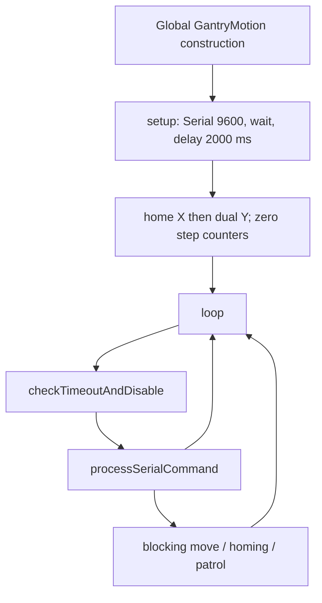
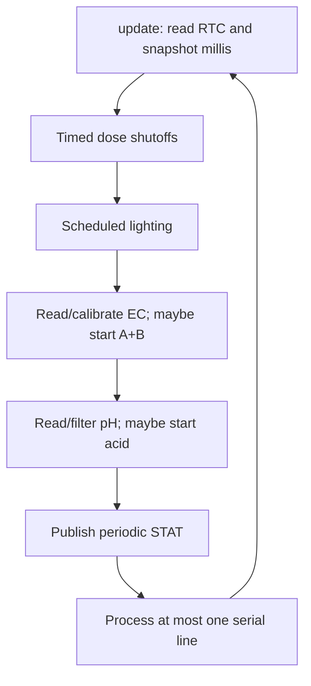

# Controller firmware programming handover

> November 2026 update: this is a detailed source reference. Start with the [current handbook](PROGRAMMING-HANDBOOK.html). The [owner's successful prototype report](reference/prototype-test-confirmation.html) covers the software branch and both updated Nano versions. The [Hiwonder chapter](09-hiwonder-arm-controller.html) supplies the now-confirmed controller and PC tool, official loading route and development references; the [report and asset note](10-reference-context-and-assets.html) adds subsequent report/dataset evidence. Original dates below identify the earlier review session, not a new deployment test.

This chapter explains the **structured firmware first**, then compares it with the preserved legacy sources. Evidence date: **2026-10-09**; source commit: `f6d8c6003382ca38fc7969202015d7ee22dfce84` on `refactor/gui-architecture`. Source inspection establishes programming behavior, not which image is currently flashed or whether a physical result is correct. No firmware was compiled, uploaded, or run for this handover.

Read the [code map](01-system-and-code-map.html), [communications chapter](03-communications.html), and [maintenance backlog](07-maintenance-and-open-issues.html) alongside this chapter. The [controller responsibility map](reference/controller-responsibility-map.html) establishes ownership: the Gantry Nano controls motion; the Hydroponics Nano controls sensing, RTC lighting, and outputs; the Pi coordinates both and commands a **separate arm controller**. The arm controller's firmware is absent from this repository.

## Which source to maintain

| Purpose | Sources | Interpretation |
|---|---|---|
| Structured Gantry entry point | [gantry_main_refactored.ino](../../source%20code/gantry_main_refactored/gantry_main_refactored.ino) | `setup()` homes; `loop()` calls the command processor |
| Structured Gantry configuration | [GantryConfig.h](../../source%20code/gantry_main_refactored/GantryConfig.h), [GantryConfig.cpp](../../source%20code/gantry_main_refactored/GantryConfig.cpp) | Constants and step-position arrays |
| Structured Gantry motion | [GantryMotion.h](../../source%20code/gantry_main_refactored/GantryMotion.h), [GantryMotion.cpp](../../source%20code/gantry_main_refactored/GantryMotion.cpp) | AccelStepper instances, blocking moves/homing, enable outputs, fault halt |
| Structured Gantry commands/state | [GantryCommandProcessor.h](../../source%20code/gantry_main_refactored/GantryCommandProcessor.h), [GantryCommandProcessor.cpp](../../source%20code/gantry_main_refactored/GantryCommandProcessor.cpp) | Parser, snake tracker, patrol, inactivity and enabled state |
| Structured Hydroponics entry point | [NFT_Hydroponics_refactored.ino](../../source%20code/NFT_Hydroponics_refactored/NFT_Hydroponics_refactored.ino) | Constructs controller; `setup()` delegates to `begin()`, `loop()` to `update()` |
| Structured Hydroponics implementation | [HydroponicsController.h](../../source%20code/NFT_Hydroponics_refactored/HydroponicsController.h), [HydroponicsController.cpp](../../source%20code/NFT_Hydroponics_refactored/HydroponicsController.cpp) | Owns all runtime state, RTC, conversions, timers, commands, and status |
| Structured Hydroponics constants | [HydroponicsConfig.h](../../source%20code/NFT_Hydroponics_refactored/HydroponicsConfig.h) | Timestamped-baseline pins, calibration, defaults, and intervals |
| Legacy Gantry comparison/rollback | gantry_main.ino, GantryController.h, GantryController.cpp | Already a three-file implementation; keep the matching files together |
| Authoritative legacy Hydroponics comparison/rollback | timestamped sketch | Source used to build the parallel controller |
| Historical Hydroponics reference | NFT_Hydroponics.ino | Different single-letter/range protocol and raw `STATUS:` readings; never substitute it for the timestamped sketch |

The owner subsequently reported successful prototype use of both structured firmware versions. Exact flashed revision and individual fault tests were not recorded; the source comparisons below remain relevant to maintenance. The older [architecture document](reference/refactored-architecture.html) correctly describes the split, but its claim that the structured homing fault does not disable drivers is stale. Commit `677d49825f21b499c83f9b9dcec479bb66922a8f` (**2026-07-30**, `Debounce`) changed homing and fault handling in `GantryMotion.cpp`, with source-text tests. The exact differences are recorded below. The [refactoring-status](reference/refactoring-status.html) phase-7 row describes future work too broadly: baseline Gantry is already modular and parallel firmware exists in Git. Neither fact proves physical validation.

## Gantry startup, ownership, and execution



`GantryMotion` is globally constructed before `setup()`. Its constructor creates three `AccelStepper` objects in `DRIVER` mode, configures endstop input pull-ups and driver-enable output modes, sets maximum speeds and acceleration, and applies direction inversion. Unlike the Hydroponics controller constructor, it calls Arduino I/O functions during global construction. Source order is established; the deployed core's startup initialization and physical enable state are not characterized here. Neither Gantry setup explicitly calls `enableMotors()` before initial homing; keep that fact separate from the processor's initial `motorsEnabled_ = true` bookkeeping.

`setup()` opens Serial at 9600, waits in `while (!Serial)`, waits 2000 ms, prints `INIT: Starting homing on startup...`, calls `homeAllAxes()`, zeros all step counters, and prints `INIT: Homing complete. Ready.` Startup therefore requests movement without a Pi command. Reset/reopen behavior depends on the deployed board/USB bridge; a serial reopen must not be treated as a harmless status read.

`GantryCommandProcessor` owns `currentCol_`, `currentRow_`, `lastCommandTime_`, and `motorsEnabled_`. `GantryMotion` owns step counters and target positions. These are distinct state domains: the snake tracker is not a sensor measurement. Everything runs on Arduino's single main execution path; there are no firmware worker threads. Calling a blocking motion method prevents the outer loop from processing ordinary commands and inactivity checks until the method returns.

| Major symbol | Called by / inputs | Output, shared state, and completion |
|---|---|---|
| `GantryMotion::GantryMotion()` | Global object construction | Configures pins/steppers; stores motion state; no serial completion |
| `homeAllAxes()` | Setup, `0 0`, re-enable, inactivity | Calls X then dual-Y bump homing; emits `Homing complete.`; no `POS` |
| `bumpHomeX()` / `bumpHomeDualY()` | Full home; dual-Y also from `O` | Fast approach, retract, slow approach; zeros corresponding counters; approach timeout calls permanent fault halt |
| `goToGridPosition(col,row)` | Validated numeric command, Next, patrol; one-based coordinates | Converts arrays to steps; emits `START`, runs all axes until counters reach targets, emits `POS`, waits 200 ms; no physical arrival feedback |
| `moveXRelativeSteps(steps, intervalMm, rightDirection)` | `L/R`, one repetition and 10 mm | Converts mm to `long` steps, clamps targets, moves X, waits 200 ms per repetition; emits no `POS` |
| `moveYBy(deltaMm)` | `U/D`, signed 10 mm | Uses Y1 current counter for both Y targets; clamps, moves, waits 200 ms; emits no `POS` |
| `GantryCommandProcessor::processSerialCommand()` | Outer loop | Reads one line, trims, dispatches; changes tracker/timestamp/enabled flag; can block on serial or motion |
| `goNextGridPosition()` | `G` | Advances one-based snake tracker before moving; duplicated `START`; wraps after last cell |
| `patrolGrid()` | `P` | Visits all 24 cells locally; checks `X` between moves; does not update the Next tracker |
| `checkTimeoutAndDisable()` | Before serial parsing each loop | If enabled and idle at least 60000 ms, homes, disables, marks false, refreshes timestamp |
| `errorStop(axisName)` | Homing approach timeout | Refactored implementation stops speed and writes disable outputs, prints error, loops forever; no serial recovery |

### Grid, coordinates, and constants

External grid coordinates are `col = 1..6`, `row = 1..4`; the step arrays use `[row - 1][col - 1]`. `goToGridPosition()` assumes a valid coordinate and indexes before clamping the resulting target. Validation is owned by the command processor and internally generated patrol/Next coordinates, not the motion helper itself.

`X_POSITIONS_STEPS` contains measured legacy values in step counts:

| Row | Col 1 | Col 2 | Col 3 | Col 4 | Col 5 | Col 6 | Y steps |
|---|---:|---:|---:|---:|---:|---:|---:|
| 1 | 900 | 5980 | 11100 | 16100 | 21220 | 26520 | 0 |
| 2 | 900 | 5980 | 11100 | 16100 | 21220 | 26520 | 6800 |
| 3 | 900 | 6280 | 11300 | 16100 | 21520 | 26520 | 13600 |
| 4 | 900 | 5980 | 11100 | 16100 | 21220 | 26520 | 18934 |

These arrays drive actual grid commands; do not replace them with a uniform-spacing equation. Row 3 intentionally has different X values in the checked-in source. Homed step-counter zero is **not grid cell `(1,1)`**, whose X target is 900. Pi plant numbering is explained in the [code map](01-system-and-code-map.html).

| Constant or calculation | Current value / meaning |
|---|---|
| `STEPS_PER_MM_X`, `STEPS_PER_MM_Y` | 40 and 26.667; source conversion factors, not newly measured distances |
| `MOVE_SPEED_MM_PER_SEC` | 300; maximum step rate is 12000 X and approximately 8000.1 Y steps/s |
| `ACCELERATION_STEPS_PER_SEC2` | 5000 on every channel; unit is steps/s² rather than mm/s² |
| Fast / slow homing | 75 / 10 mm/s; multiply by the corresponding axis step/mm factor |
| Bump distance | 10 mm; converts to 400 X steps and truncates 266.67 to 266 Y steps |
| Approach timeout / debounce | 15000 ms per fast or slow approach; 50 ms stable LOW confirmation |
| Homing / motion settle | 100 ms after slow home; 200 ms after normal movement |
| `MIN_X_STEPS`, `MIN_Y_STEPS` | Both 0 |
| `MAX_X_STEPS` | `((6-1)*130 + 55)*40 = 28200` |
| `MAX_Y_STEPS` | `((4-1)*240)*40 = 28800`; retains factor 40 despite Y conversion 26.667 |
| Relative commands | 10 mm; X ±400 steps, Y signed float product truncated to `long` (±266 steps) |
| Inactivity / startup | 60000 / 2000 ms |

X/Y1 direction inversion is `setPinsInverted(true,false,false)`; Y2 uses `(false,false,false)`. Source pin assignments are X step/dir 2/3, Y1 4/5, Y2 6/7, limits 8/9/10 (`INPUT_PULLUP`, LOW asserted), and enables A0/A1/A2 (LOW enable, HIGH disable). These values are programming contracts; this chapter does not establish wiring correctness or installed polarity.

### Homing and pre-existing refactor differences

Both implementations home X before dual Y. Each axis performs a negative constant-speed fast approach, a positive 10 mm retract with accelerated `run()`, and a negative slow approach. X has one switch; dual Y has independent confirmations so one side can cease scheduled pulses while the other continues. Fast and slow phases each have their own 15-second timeout and require 50 ms continuous LOW before success. Bump-retract loops have **no timeout** and do not process serial commands. After slow success, delay 100 ms and set counters to zero.

Current refactored `bumpHomeX()` and `bumpHomeDualY()` set the affected speed to zero immediately on the first LOW edge and debounce without calling that axis's `runSpeed()`. If the switch returns HIGH before confirmation, they restore the configured approach speed. At successful approach exit they use `setSpeed(0)` before the next phase.

| Boundary | Legacy `GantryController` | Current refactored `GantryMotion` | Evidence/limit |
|---|---|---|---|
| X debounce | Calls `runSpeed()` during the 50 ms LOW confirmation window | Sets speed zero at first edge; no `runSpeed()` while confirmed; restores speed on bounce | Intentional change in `677d498`; source/static desk evidence only |
| Dual-Y debounce | Suppresses each confirmed side's `runSpeed()`, but leaves its configured speed unchanged | Additionally sets speed zero and restores it on bounce | Same commit; physical squareness/stopping behavior unverified |
| End of approach | Calls `stop()` without a following deceleration run loop | Calls `setSpeed(0)` | Same commit; do not claim behavioral equivalence |
| Homing fault | Prints error; calls `stop()` on each stepper; infinite loop; does not explicitly disable | Sets each speed zero; `disableMotors()` (and its `Motors disabled.` line); then error and infinite loop | Serial diagnostic order and enable writes differ; physical outcome unverified |

[test_gantry_firmware_safety.py](../../source%20code/Raspberry%20Pi/GUI/refactored/tests/test_gantry_firmware_safety.py) reads C++ as text and checks fault disable ordering and X debounce source patterns. It neither compiles nor simulates AccelStepper, and does not demonstrate Y behavior or a physical stop. The older architecture/deployment records must be read with the above differences in mind. This handover adds comments only and does not introduce or undo these changes.

### Commands, inactivity, and error paths

The [protocol baseline](reference/pi-nano-protocol.html) and [communications chapter](03-communications.html) carry the full wire contract. The programming dispatch order is:

1. If bytes are available, `readStringUntil('\n')`, trim, return on an empty line. No explicit firmware `Serial.setTimeout()` is present in either current Gantry source; partial lines can block according to the selected Arduino core's Stream timeout.
2. Handle `O` **before** the disabled-state recovery branch: print its diagnostic, home dual Y, disable outputs, mark disabled, refresh command time, return. Sending `O` while already disabled still takes this dual-Y home path without first explicitly enabling outputs.
3. Any other nonempty line received while disabled first enables outputs, fully homes, zeros counters, and resets tracker to `(0,0)` **before the command is validated**. Even an invalid command can trigger this motion.
4. Refresh command time, then dispatch `P`, `G`, single-letter `U/D/L/R`, or a string containing a space. Unknown single letters and invalid formats receive text errors.
5. Parse numeric fields with `String::toInt()`. `(0,0)` homes and resets tracker; otherwise enforce 1..6 and 1..4, update tracker, and call grid motion. Conversion is permissive; malformed numeric text can become zero, so lexical validation is absent. `0 0` emits no `POS`.

`G` traverses `(1,1)..(6,1)`, `(6,2)..(1,2)`, `(1,3)..(6,3)`, `(6,4)..(1,4)`, then wraps. Direct grid commands update this tracker; relative moves do not. Firmware patrol does not synchronize the tracker to its ending cell. `G` and `P` each print a `START` that is printed again by grid motion. A patrol cell waits 200 ms inside motion plus 200 ms in patrol; a direct grid/Next move waits only the inner 200 ms.

Patrol reads available lines at row/cell boundaries and checks only `X`. Non-`X` lines read there are consumed without normal dispatch. `X` outside patrol is an unknown single-letter command. No command interrupts an active grid, relative, homing, or retract loop.

The inactivity check runs **before** command parsing. A waiting command can therefore encounter timeout homing first. Timestamp refresh occurs before long `P/G/grid` execution, not after each move: long blocking operations can finish after the 60-second threshold and cause homing/disable on the next loop. There is no continuous endstop acquisition or progress timeout in normal movement; `POS` means the internal step counters reached their requested targets, not that an external position sensor verified arrival.

The legacy header declares `Activate_Gantry()` without a matching definition/call in the inspected Gantry files; do not treat it as an available recovery API. Neither implementation supports fault recovery through Serial once `errorStop()` has entered its permanent loop.

## Hydroponics lifecycle and state

The refactored sketch globally constructs a `HydroponicsController` whose constructor assigns state defaults and performs no I/O. `begin()` starts Serial 9600 and Wire (the Nano's internal RTC I²C bus), configures pins, writes initial output levels, and initializes the DS3231 RTC. If `rtc_.begin()` fails, it prints `RTC missing!` and halts forever after initial output writes. If the RTC reports lost power, it adjusts to **build-time** `__DATE__`/`__TIME__`; no runtime synchronization from the Pi or timezone handling is implemented.

Startup writes chemical outputs LOW, water/light HIGH, then toggles light LOW/HIGH twice at 200 ms per phase (800 ms total). The light bookkeeping remains false through this blink. Scheduled lighting is applied on the first `update()`, not by an extra schedule step in `begin()`. Initialization then calculates EC and pH coefficients.

Reset defaults are: 5000 ms default dose, lighting 07:00 inclusive to 19:00 exclusive, all dose flags false, manual light override false, auto EC/pH disabled, targets zero, all start/cooldown/status timestamps zero. Settings are in RAM; there is no EEPROM persistence. The RTC may retain time independently, but source does not prove its battery condition.



| Major symbol | Caller / inputs | Outputs, side effects, and constraints |
|---|---|---|
| `begin()` | Sketch `setup()` | Serial/Wire, pin/output initialization, RTC, blink, coefficients; permanent halt on missing RTC |
| `update()` | Sketch `loop()` | One RTC/`millis()` snapshot; fixed update order above; all state stays on the main path |
| `updateTimedShutoffs(nowMs)` | First step of `update()` | Writes active outputs off when elapsed duration reached; clears corresponding flags |
| `updateLightingState(now)` | After shutoffs; RTC hour | Applies schedule only without manual override; changes relay only on logical-state change |
| `updateEcAutoDose(currentEc,nowMs)` | After one EC ADC read | Starts fertilizer A+B together if enabled, below target, inactive, and cooldown permits |
| `updatePhAutoDose(currentPh,nowMs)` | After filtered pH read | Starts acid if enabled, above target, inactive, and cooldown permits |
| `publishStatus(currentEc,currentPh,nowMs)` | After both auto checks | Every >=1000 ms emits sensor values and logical/output states; reads water ADC here |
| `processOneSerialCommand(nowMs)` / `processCommand(command,nowMs)` | Last update step | At most one line; trim, split first colon, uppercase; change settings/outputs with no ACK |
| `processDoseCommand(value,nowMs)` | `DOSE` command | Splits type and optional mL, activates only an inactive matching channel |
| `calibrateEc(raw)` | Update | Linear ADC-to-value conversion with lower clamp; no fault detection |
| `readPh()` | Every update, even if auto pH disabled | 100 ADC reads/delays, descending sort, trimmed average, mV conversion, piecewise pH |
| `calibrateWaterPercent(raw)` | Status publication | Cubic ADC polynomial clamped 0..100%; no dosing interlock |

### Timing, dosing, and blocking

`doseTimeMs_` starts at 5000. EC and pH auto cooldowns are independently 600000 ms (10 minutes), measured from **auto-dose start**, with zero meaning no previous dose. EC starts A+B when `currentEc < ecTarget_`; pH starts acid when `currentPh > phTarget_`. Equality does not start a dose. Checks are not coupled: acid, A+B, and pesticide can overlap. There is no water-level interlock, plausibility gate, stability requirement, maximum cumulative dose, or upper target/duration bound in firmware.

Manual positive ACID/FERT mL converts to `unsigned long(mL * 1000)` and sets a manual-duration flag. Omitted, zero, or negative amount falls back to the current global duration and does not set that flag. A manual request while that channel is already active is silently ignored; it does not restart or extend the timer. Manual dosing does not refresh auto cooldown timestamps, so when a manual dose ends an auto dose can start in the same update if its conditions allow. Auto target disable stops future starts, not an active dose.

Pesticide parses the amount but ignores its computed duration: shutoff always compares against the **current** global `doseTimeMs_`. `DOSE_TIME` can change the duration of an already active auto/fallback/pesticide dose because the next comparison reads the global setting; positive manual ACID/FERT keeps its captured manual duration. There is no serial command to stop an active chemical output immediately.

Timers use unsigned elapsed subtraction, but are cooperative rather than interrupts. `readPh()` incurs 100 one-millisecond delays plus ADC work and an O(n²) sort every iteration. `readStringUntil('\n')` can also block for an incomplete command; neither timestamped nor structured firmware sets a custom Stream timeout. Exact default timeout depends on the captured Arduino core, which is missing. Timed shutoffs and status cannot run during those blocks.

The `nowMs` passed through the update is captured **before** pH sampling and command reading. Acid/manual command start timestamps can therefore predate their actual HIGH write by the work already performed in that iteration. A dose's pin-on interval is not an exact mL-to-seconds guarantee; loop/serial delays and stale snapshot timing affect it. Status is published before the command, so newly requested output state usually first appears in a later record. Serial loss alone does not turn off persistent water/light outputs or disable autonomous rules; a stalled Nano loop is a separate unresolved failure case.

### Sensor formulas and units

An ADC value is the integer returned by `analogRead()`; ADC means analog-to-digital conversion. The pH equation assumes a 5 V reference and 1024 conversion denominator. Source captures the calculation, not actual supply/reference voltage, calibration provenance, sensor health, or accuracy.

| Conversion | Current source formula and constants | Interpretation |
|---|---|---|
| EC | `slope = (12880 - 84)/(439 - 64)`; `intercept = 84 - slope*64`; result `max(0, raw*slope + intercept)` | Anchors raw 64 → 84 and 439 → 12880; approximately slope 34.1227 and intercept -2099.85. GUI presents µS/cm; firmware serial fields contain no explicit unit tag. Do not infer calibrated accuracy |
| pH sample preparation | Read 100 samples with 1 ms delay each; sort descending; discard highest 20 and lowest 20; average indices 20..79 | Middle 60 values, not a single ADC read or median |
| pH voltage | `mv = meanRaw * 5000 / 1024` | Millivolts; reference assumption remains unverified |
| pH slopes | `K1 = (686-400)/abs(2773-2275)`; `K2 = (918-686)/abs(2275-1889)` | Approximately 0.5743 and 0.6010 **hundredths of pH per mV** |
| pH piecewise | If `mv < 2275`: `(2275-mv)*K1 + 686`; otherwise `686-(mv-2275)*K2`; clamp 0..1400 then divide 100 | Preserve this actual branch/slope pairing; it uses K1 on the low-voltage side and K2 on the high-voltage side, despite the named calibration endpoints suggesting the opposite association. Physical calibration evidence is missing |
| Water | `2.30841033e-5*raw³ - 1.37886629e-2*raw² + 2.74150783*raw - 9.29694804e1`, clamp 0..100 | Percent according to embedded cubic fit; no volume/tank-height calibration established |

At the named pH endpoints the preserved formula does not exactly return 4.00 and 9.18: this is a source-math observation, not permission to swap slopes. ECcalibration.ino and pHcalibration.ino are separate utilities; their pins/constants must not silently replace the active configuration. The [vision/assets chapter](05-vision-and-assets.html) and [evidence record](08-evidence-and-change-record.html) inventory historical software assets.

Source pins are acid 2, fertilizer B 3, fertilizer A 4, water 5, light 9, pesticide 10, water ADC A0, EC A1, pH A2. Chemical HIGH means requested on in the code; water/light LOW means requested on. NO/NC (normally open/closed) labels are inherited source intent. This is not a wiring deliverable or proof of installed relay/load behavior.

### Lighting, settings, and status

Lighting uses `hour >= lightOnHour_ && hour < lightOffHour_`. Hours are 0..23; minutes/seconds are ignored. This expression supports a same-day interval, not an overnight wrap: on 19/off 7 or equal hours never satisfy both comparisons. `LIGHT:ON/OFF` sets a manual override that persists until a valid `LIGHT_ON_HOUR` or `LIGHT_OFF_HOUR` command clears it, or controller reset. It does **not** automatically clear at the next time threshold as the historical root sketch did.

`processCommand()` uppercases key/value after splitting the first colon. `WATER_PUMP`/`LIGHT` treats exactly `ON` as on and every other value as off. `TARGET_EC/PH` enables automation for a positive parsed value; zero/negative disables it while leaving the previous stored positive target. Hour values are parsed through `toInt()` and accepted if 0..23. `DOSE_TIME` accepts parsed values >=0 and multiplies by 1000; a zero setting is allowed. `String::toFloat()`/`toInt()` is permissive: malformed text can become zero, which can disable a target, accept hour 0, or set zero duration. Unknown commands are silent. No ACK, settings readback, or transaction identifier is added by the refactor.

`publishStatus()` emits the baseline ten fields:

```text
STAT,<millis>,<water-percent>,<ec>,<ph>,<light>,<water-pump>,<acid>,<fert>,<pesticide>
```

Water/EC print one decimal; pH prints two. Boolean fields print `1`/`0`. Light is `lightState_`; water is `digitalRead(PIN_WATER_PUMP) == LOW`; acid/fertilizer/pesticide use active flags. Fertilizer is one combined A+B flag. These are controller software/output states, not feedback that liquid flowed or light was produced. `millis` is controller uptime, not RTC wall time. `lastStatusTime_` advances to the current snapshot; missed intervals are not replayed. The [communications chapter](03-communications.html) traces how the structured Pi buffers/parses records and updates GUI state.

### Refactored versus legacy Hydroponics

The refactor extracts global state into members, constants into a header, `setup()` into `begin()`, and the update phases into private helpers. Inspection found the timestamped baseline's update order, sensor math, RTC lost-power behavior, light override, timers, output polarity, and command/status contract retained. This is a source comparison, not a compile, serial transcript, or physical equivalence result. Its constructor initializes all member state explicitly; the baseline's status timestamp is a function-static zero instead of `lastStatusTime_`.

The historical root sketch is intentionally different: single-letter A/F/P/L/W commands, EC/PH min/max ranges, raw ADC readings in `STATUS:` with RTC timestamps, fixed 5000 ms doses, no ten-minute auto cooldown, 250 ms blink phases, and threshold-crossing override release. A similarly named `.ino` file is insufficient to identify compatible firmware.

## Build, recovery, and maintenance boundaries

The evidenced libraries are `AccelStepper` for Gantry and `Wire` plus `RTClib` (`RTC_DS3231`, `DateTime`) for Hydroponics, with Arduino core APIs. The repository describes Nano controllers but does not capture a verified fully qualified board name (FQBN), processor/old-bootloader choice, board/core version, compiler flags/version, library versions, flashed hashes, reproducible binary images, or tested rollback upload recipe. Do not invent an `arduino-cli compile` command or install a convenient library to fill those gaps.

Maintain complete sketch folders: the Gantry `.ino` depends on its matching `.h/.cpp` files; the Hydroponics refactored `.ino` depends on its matching controller/config files. Legacy rollback uses the matching three-file Gantry folder and the **timestamped** Hydroponics folder. Source in Git is not a verified copy of a controller's flash. [Development and recovery](06-development-testing-and-recovery.html), [Pi deployment manifest](reference/pi-deployment-manifest.html), and [future deployment/validation plan](reference/refactored-deployment-and-validation-plan.html) describe the remaining evidence and approval gates; none of their physical procedures was executed for this task.

For the next software change, capture inputs/outputs and constants before changing parser, timing, conversion, motion, or dosing behavior. Use offline fixtures/static checks first, distinguish the pre-existing structured homing changes from pure extraction, and retain a reversible diff. Physical testing requires separately authorized procedures and a record of hardware state, expected/observed outcome, date, and operator. Mechanisms, wiring/electronics design, calibration experiments, actual pump flow, and physical commissioning are deferred.
