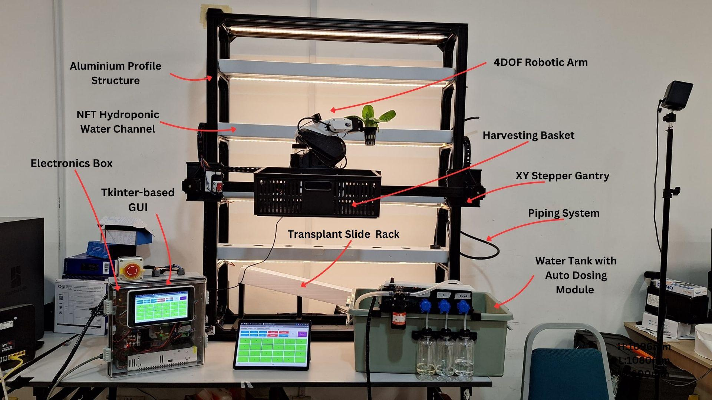

# Project report and programming assets

This note connects the current software to the owner's original project report, subsequent prototype photographs and saved vision assets. The report explains the design intent and experiments; current source establishes the implemented parameters. An older report value should not silently replace a current source setting.

## Prototype and interface photographs

The following are original owner photographs or figures from the owner-supplied **KIG3011 Semester 2 Group 21 report**. The GUI screenshots illustrate the original interface and may differ in detail from the structured application. They are not screenshots of a newly executed program.

| Resource | What to look for |
|---|---|
| [Complete prototype](media/prototype-overview.jpg) | Plant channels, gantry and arm in their physical context |
| [Main controller enclosure](media/controller-enclosure.jpg) | Pi, two Nano boards and motor drivers; shows controller ownership in the actual build |
| [Arm and moving cables](media/arm-and-cables.jpg) | Arm assembly and cable route; the Hiwonder board is housed with the arm |
| [Dashboard](media/dashboard.png) | Plant positions and operator status layout |
| [Gantry and arm interface](media/gantry-arm-interface.png) | Motion and arm controls in the original report |
| [Hydroponics interface](media/hydroponics-interface.png) | Sensor display, water, nutrient and lighting controls |
| [Vision interface](media/vision-interface.png) | Image capture and inference presentation |
| [Example plant detections](media/example-detections.jpg) | Example annotated camera results from the report |

The report photograph supplies overall orientation. For detailed controller behaviour, use the handbook and source rather than inferring control ownership from the physical layout.

## Report context for vision development

The original report's sections **3.2.6 Dataset Preparation and Model Training** and **3.4.5 Model Training Outcome and Performance Evaluation** describe a YOLOv8 crop-maturity/disease model. The reported crop families are bok choy, lettuce and sweet basil. The report describes nine intended classes covering immature/mature crops, white flies, Septoria and anthracnose. Its reported training setup used 100 epochs on an RTX 3060 laptop with a Ryzen 5 5600H and 64 GB RAM.

The selected report text and tables are retained in [report evidence](reference/report-programming-extract.html). They preserve the original claims for future investigation rather than claiming a newly reproduced experiment. The training scripts, exact training run and a verified linkage between that run and the active `bestv5.pt` hash are still needed for a reproducible model replacement.

Three distinctions matter when extending the program:

1. **Confidence threshold:** the report discusses 0.815 in its evaluation/deployment narrative. Current application source uses a 0.3 eligibility threshold. Preserve the source value until a deliberate comparison justifies a change.
2. **Metrics:** the report's training summary gives mAP50 98.2%, precision 98.0% and recall 98.5%; its later evaluation table gives 0.990, 0.995 and 0.989 respectively. Keep those results with their original sections and conditions. They are not a single newly verified performance rating for the installed model.
3. **Class strings:** report descriptions, dataset folder names and runtime `model.names` are different sources. The application tests case-sensitive substrings such as `Immatured` and `Matured`. Capture the actual model class map before changing labels or training a replacement; an unexpected label currently falls into pesticide handling in Full Auto.

The enclosure photo also shows a Raspberry Pi AI HAT marked 26 TOPS. The checked application selects Ultralytics/Torch; the presence of the HAT does not establish that the current inference code uses Hailo acceleration.

## Saved dataset metadata

The repository includes a Roboflow folder export at `IDP V2/GrowTechWall.v1i.folder/`. Its two metadata files identify **GrowTechWall v1**, exported **11 May 2025**, and declare **CC BY 4.0**. They describe 2,349 images, folder-format annotations, auto-orientation, 640 by 640 fit-within resizing and three augmented versions of each source image.

The metadata's augmentation settings are horizontal shear ±14 degrees, vertical shear ±6 degrees, brightness ±23%, exposure ±13%, Gaussian blur up to 2.9 pixels and salt-and-pepper noise at 1.49%. These differ from the report's augmentation narrative and larger dataset counts. Do not assume that this earlier export was the dataset used to produce `bestv5.pt`.

- [Original dataset metadata copied into this handover](reference/dataset/README.dataset.txt)
- [Original export metadata copied into this handover](reference/dataset/README.roboflow.txt)
- [Actual local folder and file inventory](reference/dataset/inventory.json)
- [Dataset source URL recorded by the export](https://universe.roboflow.com/tan-wvn2v/growtechwall)
- Dataset images are excluded from this selected current-source handover; the original metadata and inventory below remain as historical training context.

The dataset URL is provenance from the saved metadata, not a new check of its availability or contents. CAD library now contains only the owner-supplied assembly Pack and Go ZIP. Training images are excluded from this handover; inference uses the included active bestv5.pt. Dataset metadata remains for historical context.

## Models and action files

The package includes the actual **active `bestv5.pt`** file at its original repository-relative location. Under source code/Raspberry Pi/GUI/, its SHA-256 is `87c36a815ee6a0efdde2bcb71bec5b6cb1b8855a4958646df56f4afdc8ef9f19`. It is included for recovery; it was not loaded or executed while preparing this handover.

[Model inventory](reference/model-assets.json) records every retained model's size, SHA-256 and inclusion status in this folder. Alternative weights are excluded from the selected current source; their historical metadata remains for traceability. In particular, `bestv3.pt` has the same bytes as `bestv5.pt`; a filename alone is not a quality ranking or an instruction to substitute a model.

All twelve original `.rob` action files are included. [Action inventory](reference/arm-action-assets.json) supplies their hashes. See [Hiwonder controller guide](09-hiwonder-arm-controller.html) before using these files to program the board: the currently installed slot mapping cannot be proven from filenames.

## What a replacement installation still needs

The ZIP contains project files, not a preconfigured Pi disk image. A replacement installation needs a compatible operating system and Python/Arduino environment, reviewed UART/USB/display settings, actual board identities, and the installed action/servo mapping. The [deployment manifest](reference/pi-deployment-manifest.html) and [recovery guide](reference/new-pi-recovery.html) explain the captured configuration and remaining setup evidence.

Private SD-card images, credentials and account tokens are outside the handover package. Vendor installers and full manuals remain official links. CAD, simulation results and mechanical manufacturing assets belong to the separate mechanical package.

## Original project report

The [complete owner report](../reference/Project%20reports/KIG3011_Sem%202_Report_G21.docx) is included unchanged. It preserves original design, experiment and photograph context; later owner corrections and current source take precedence for the present build.
