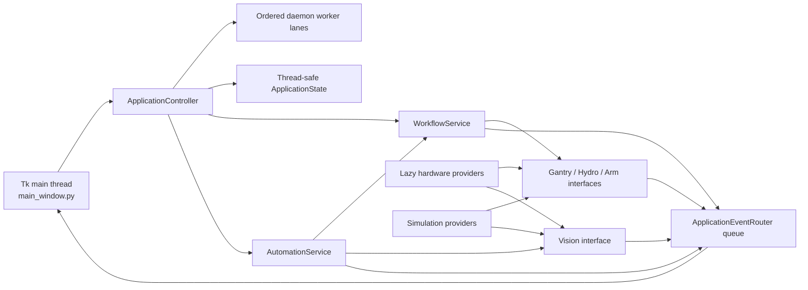

# GrowTech Wall refactored architecture

> Current-source note (2026-10-09): Use the [2026-10-09 programming handover](../README.html) for current-source detail. In particular, refactored gantry homing/fault behavior changed in commit 677d498, reset now includes vision, and current legacy per-arm position refresh is absent from the refactor. The original architecture account below predates these differences; see the [reconciliation record](../08-evidence-and-change-record.html).

## Evidence status

This document describes the parallel rewrite created from the Phase 1 source-verified legacy baseline. The new code is **desk-verified future work**, not hardware-validated software. It has not been used to open the deployed camera or serial ports, drive the Gantry or robotic arm, switch a relay, operate a pump, or upload either Nano.

The legacy operational source, firmware, models, calibration sketches, and arm action files remain unchanged and are the behavior/rollback reference. A statement that the rewrite preserves a value means that the value has been compared with repository source and tested statically or in simulation; it does not claim the physical result has been reproduced.

## Design boundary

The four controller endpoints and their ownership remain unchanged:

| Endpoint | Preserved ownership | Refactored Pi role |
|---|---|---|
| Raspberry Pi GUI/vision/coordinator | Tk GUI, USB camera, YOLO inference, image storage, operator commands, cross-controller workflows | Owner |
| Gantry Arduino Nano | X/Y steppers, dual-Y synchronization, endstops, homing, measured grid, driver enable/disable, motion timeout | Text-protocol client |
| Hydroponics Arduino Nano | RTC, water/EC/pH sensing and conversion, light schedule, water relay, fertilizer A+B, acid and pesticide outputs, automatic dosing | Text-protocol/status client |
| Robotic-arm action controller | Deployed binary action groups | Native-UART binary client |

The Pi still does not own Gantry pins, Hydroponics sensor acquisition, or Hydroponics relay pins. The arm remains a separate endpoint reached directly over `/dev/ttyAMA1`, not through either Nano. The inactive `/dev/arduino_roboticarm` udev alias is not used.

## Parallel source layout

```text
Raspberry Pi/GUI/refactored/
|-- app.py
|-- config/
|   `-- settings.py
|-- domain/
|   |-- grid.py
|   `-- models.py
|-- comm/
|   |-- clients.py
|   |-- interfaces.py
|   |-- line_parser.py
|   |-- protocols.py
|   `-- serial_transport.py
|-- vision/
|   |-- hardware.py
|   `-- logic.py
|-- services/
|   |-- automation.py
|   |-- controller.py
|   |-- events.py
|   |-- state.py
|   |-- worker_lane.py
|   `-- workflows.py
|-- simulation/
|   |-- controllers.py
|   `-- vision.py
|-- gui/
|   `-- main_window.py
|-- utils/
|   |-- errors.py
|   `-- logging_config.py
`-- tests/

gantry_main_refactored/
|-- gantry_main_refactored.ino
|-- GantryConfig.h
|-- GantryConfig.cpp
|-- GantryMotion.h
|-- GantryMotion.cpp
|-- GantryCommandProcessor.h
`-- GantryCommandProcessor.cpp

NFT_Hydroponics_refactored/
|-- NFT_Hydroponics_refactored.ino
|-- HydroponicsConfig.h
|-- HydroponicsController.h
`-- HydroponicsController.cpp
```

Package `__init__.py` files make the Python boundaries explicit. Root `requirements-dev.txt` describes laptop test needs, while `requirements-pi.txt` is a proposed direct-runtime dependency baseline derived from the captured Pi environment.

## Python composition and startup

`app.py` is the only supported refactored entry point:

```text
python app.py --simulate   # laptop/mock providers
python app.py              # Raspberry Pi/hardware providers
```

Startup has four deliberate stages:

1. Parse the requested mode and construct immutable configuration.
2. Compose either simulation providers or hardware providers behind the same controller/vision interfaces and construct the instance-owned worker lanes.
3. Explicitly start the selected providers in the preserved order: vision, arm, Gantry, then Hydroponics.
4. Create the Tk main window and enter the Tk event loop.

Importing modules performs configuration and class/function definition only. It does not instantiate Tk, load a model, create an OpenCV capture, import `ServoControl.py`, import pyserial, open a tty, start a thread, or send a command. Hardware-only dependencies are loaded inside the explicit hardware composition path. Before those imports, hardware mode requires Linux/aarch64 plus Raspberry Pi device-tree model evidence; an unverified host is rejected with instructions to use `--simulate`. This is what makes the standard-library tests safe on Windows and prevents `--simulate` from touching Pi interfaces.

`AppConfig` centralizes preserved defaults rather than scattering hard-coded values through widgets and workers. Runtime objects are constructed per application instance; there is no global mutable application state.

## Runtime dependency direction



The domain, protocol, parsing, state, workflow, and simulation layers do not import Tkinter. The GUI knows the application controller and event types, but workers do not know widgets.

## Main-thread and worker contract

- Tk widgets and Tk variables are created and accessed only by the main thread.
- Button callbacks submit work to independent ordered workflow, Hydroponics, vision, and reset lanes; they do not perform serial reads, model inference, arm sleeps, or Gantry waits in the Tk callback. A stalled Gantry wait therefore does not monopolize Hydroponics commands or Reset Serial.
- Workers publish immutable application events through `ApplicationEventRouter`, which serializes each state mutation with its matching GUI-queue publication so concurrent producers cannot reorder display state.
- `main_window.py` drains the event queue using `root.after(...)` and is the only layer that maps events to widget changes or dialogs. Rejected stale/mismatched `START` and `POS` events retain raw-log visibility but carry `accepted=false` and are not painted as current position.
- `ApplicationState` protects the requested Gantry command/target, last reported position, position-validity flag, fresh position/home generations, hydroponics readings, detections, and automation history without storing widget references. Connection display state remains event-driven.
- The application controller owns shutdown cancellation plus a reset epoch for queued/manual work; `AutomationService` owns its automation stop event and serializes stop requests with worker startup. Gantry/home waits and assumed arm-action sleeps observe those cancellation signals.
- Reset Serial advances the epoch, blocks new endpoint admission, stops the Nano transports, and waits for ordered workflow/Hydro barriers before reopening. Per-provider lifecycle locks serialize each reopen against shutdown while allowing unrelated endpoints to close independently. If prior work does not quiesce within the bounded deadline, the affected endpoint remains offline instead of being reopened beside stale work.
- Manual move/capture ordering uses a workflow-to-vision fence and a Gantry/camera I/O lock: a move submitted first must reach an accepted position before capture chooses a plant, while a later move cannot be written during an active capture.
- Shutdown signals both cancellation paths, wakes state waiters, starts daemon-owned provider closes early to unblock I/O, and gives provider cleanup plus daemon-owned lanes one shared bounded deadline. A stuck third-party call is logged rather than retaining process exit. This lifecycle cleanup cannot interrupt a command or action already sent to physical controller firmware and is not a claim that actuators have reached a safe state.

This removes the legacy cross-thread Tk access while keeping the user workflows recognizable.

## Preserved configuration defaults

| Concern | Refactored default | Legacy evidence |
|---|---|---|
| Gantry path | `/dev/arduino_gantry` | `GTW_GUIv2.py` |
| Hydroponics path | `/dev/arduino_hydroponic` | `GTW_GUIv2.py` |
| Robotic arm path | `/dev/ttyAMA1` | `ServoControl.py` |
| All serial baud rates | 9600 | Pi and both Nano sources |
| Model | `/home/growtechwall/Desktop/IDP-Grow-Tech-Wall/Raspberry Pi/GUI/bestv5.pt` | Active GUI |
| Confidence threshold | `0.3` | Active capture/inference code |
| Detection ROI | inclusive center between `w/6` and `5w/6` | Active implementation; its “middle third” comment is inaccurate |
| Detection selection | highest confidence after confidence and ROI filters | Active GUI |
| Camera | OpenCV index `0`, requested 640 by 640 | Active GUI |
| Image storage | `~/plant_images/<plant>/<YYYYmmdd_HHMMSS>.png` | Active GUI |
| Grid labels | rows `19..24`, `13..18`, `7..12`, `1..6` | Active GUI |
| Scan order | `1..6, 12..7, 13..18, 24..19` | Active GUI |
| Arm waits | groups 1–6: 4, 4, 5, 7, 1, 10 seconds | Active GUI |

Configuration centralization does not make these values physically verified. Camera alignment, label semantics, arm mapping, timing sufficiency, wiring, and calibration still require the prototype-validation plan.

## Communication architecture

### Transport and line framing

`comm/serial_transport.py` owns an explicitly opened, lock-protected transport. It preserves the two-second settle and input/output-buffer resets for both Nano ports; the native arm UART has neither settle nor buffer reset, matching `ServoControl.py`. `comm/line_parser.py` accumulates bytes until newline boundaries, returns all complete records, and retains an incomplete suffix. To preserve the legacy reader contract it decodes UTF-8 with invalid bytes ignored; the structured Gantry/Hydroponics parsers then reject malformed resulting records without touching GUI state. Gantry and Hydroponics each receive a separate parser buffer.

Complete buffering is an intentionally implemented correction to the documented legacy Hydroponics chunk-framing bug. It does not change bytes on the wire; it prevents valid fragmented or combined newline-delimited `STAT` records from being discarded. The correction is desk-verified until compared with the deployed Nano stream.

`comm/interfaces.py` defines the provider contracts used by services. `comm/clients.py` combines a transport with protocol generation/parsing. Simulation implements the same interfaces without importing the hardware transport.

### Gantry text protocol

`comm/protocols.py` preserves newline-terminated commands:

- grid: `<x> <y>` for x 1–6 and y 1–4;
- re-home: `0 0`;
- relative/sequence: `U`, `D`, `L`, `R`, `G`;
- patrol/terminate: `P`, `X`;
- legacy home-dual-Y then disable: `O`.

The client parses the existing `START x y`, `POS x y`, `STATE ...`, `TIMEOUT: ...`, motor-state, homing, and free-text diagnostic records. It does not invent acknowledgements, sequence identifiers, retries, or a new emergency-stop command.

The legacy firmware does not emit `POS` after `0 0`. A movement request invalidates the cached position. A concrete grid request accepts only a later in-range `POS` that matches the requested target and advances the report generation, so an earlier queued move cannot confirm a newer request. Each `G`/Next job similarly waits for a fresh accepted position before the next queued `G` is written. Home, disable, timeout, reset, and Gantry disconnect invalidate position and block delayed unsolicited position reports until a new explicit command replaces that state. Home waits accept the existing `Homing complete.` diagnostic and, for compatibility with the legacy GUI expectation, a fresh `POS 1 1` associated with the `0 0` request. Treating `Homing complete.` as success corrects the explicitly documented legacy handshake bug; both completion paths are desk-tested and require physical comparison before approval.

### Hydroponics text protocol

Command generation preserves:

- `WATER_PUMP:ON|OFF`;
- `LIGHT:ON|OFF`;
- `DOSE:ACID:<mL>`, `DOSE:FERT:<mL>`, and `DOSE:PEST:<mL>`;
- `TARGET_EC:<value>` and `TARGET_PH:<value>`;
- `LIGHT_ON_HOUR:<hour>` and `LIGHT_OFF_HOUR:<hour>`;
- `DOSE_TIME:<mL>`.

Status parsing preserves the ten-field record:

```text
STAT,<ms>,<water>,<ec>,<ph>,<light>,<water>,<acid>,<fert>,<pest>
```

The parser requires the legacy ten-field prefix, validates its numeric fields and `0`/`1` state fields, and tolerates additional trailing fields so an extended controller record does not invalidate the legacy portion. Short, nonnumeric, nonbinary, or wrongly prefixed records remain malformed and are reported through logging/events without crashing a worker. GUI command validation restricts values to the numeric forms and increments reachable through the legacy controls; it does not add new physical upper bounds, chemical interlocks, water-level interlocks, sensor-plausibility policy, persistence, or acknowledgements.

### Robotic-arm binary protocol

The arm client writes the legacy Lobot action-group frame over native UART:

```text
55 55 05 06 <group-id> <count-low> <count-high>
```

The current workflows use a repeat count of one, yielding `55 55 05 06 <group> 01 00`, followed by the preserved fixed wait. The protocol has no completion acknowledgement. The parallel client does not import legacy `ServoControl.py`, because that module opens `/dev/ttyAMA1` at import. It reproduces only the required frame construction behind an injected transport.

## Vision architecture

`vision/logic.py` contains dependency-free detection selection, ROI calculations, label/result modeling, and image-path construction. These functions are tested with synthetic detection metadata and temporary paths.

`vision/hardware.py` lazily imports and constructs OpenCV and Ultralytics only in hardware mode. It opens camera index `0`, requests 640 by 640, flushes stale frames, performs inference with `bestv5.pt`, filters at confidence `0.3`, accepts centers in the inclusive central two-thirds, selects the highest-confidence candidate, annotates, and saves a PNG under the preserved plant directory.

The invalid legacy ONNX fallback that feeds a `.pt` file to ONNX Runtime is not reproduced as an active fallback. This is an explicitly documented legacy defect, not a model-policy change: the refactored hardware path proposes the Ultralytics `.pt` backend already selected on the deployed environment. A future ONNX backend requires a real `.onnx` model and comparative validation.

`simulation/vision.py` supplies deterministic fixture/mock results. Simulation never opens camera index `0`, loads the model, or writes a production capture. Image-path construction and inference-failure save behavior are tested separately with temporary paths and injected fakes around the vision logic/hardware service.

Simulation controller restarts are reset-shaped: Gantry logical position/disable state and Hydroponics water/light outputs return to their firmware startup values, while command histories remain available to tests.

## GUI and workflow mapping

The initial GUI deliberately keeps the four operator landmarks, including main-thread vision popups and the legacy Hydroponics A/B/acid/water/light activity indicators:

1. **Dashboard** — controller/camera status, current sensor values, current plant/Gantry state, latest detection/image information, notifications, and serial reset/reconnect action.
2. **Gantry & Arm** — Home, Up/Down/Left/Right, Next, 24 grid positions, Harvest, Transplant, Pesticide, Scan Only/Full Auto, Capture, Stop/cancel, and legacy Disable behavior.
3. **Hydroponic** — water/light toggles, fertilizer A+B and acid manual dose, targets, automatic dose amount, light schedule, sensor/output status, and sent/received protocol records.
4. **Vision** — 24 plant cells with the latest result and manual position selection/capture workflow.

Phase 2C restores the legacy-first interaction details that were missing from the first parallel implementation. The Auto button opens a modal choice with separate **Scan Only** and **Full Auto** buttons; it is not a Yes/No/Cancel question. Transplant, Pesticide, Harvest, and Serial Reset publish an exclusive-operation state so Gantry, arm, capture, position, reset, and automation controls visibly disable while that operation runs and re-enable at its completion boundary. The Hydroponic tab again uses stepped arrow-button popups for the light schedule, automatic dose, EC target, pH target, and manual A+B/acid dose. Water and light buttons optimistically show the requested legacy state, then reconcile to later `STAT` output. Reset completion again shows `Serial ports have been reset.` Detailed endpoint failures remain visible separately.

`WorkflowService` contains the manual harvest, transplant, and pesticide sequences, including their coordinated moves. `ApplicationController` owns direct manual moves and captures, while `AutomationService` contains scan-only and full-auto state transitions. None of these services accesses widgets.

Preserved full-auto dispatch is:

| Detection result | Workflow |
|---|---|
| `No detection` or label containing `Immatured` | Arm group 5 |
| Label containing `Matured` | Harvest, then transplant |
| Other detected label | Pesticide command/action |

Harvest preserves the special column-1 move to column 2 before arm group 2 and the return to column 1. Transplant preserves rack position 6, group 3 pickup, return to the original position, group 4 plant, then group 5 idle. Pesticide preserves `DOSE:PEST:11`, group 6, then group 5.

Cancellation is checked between operations. It does not interrupt a command already executing inside blocking Nano firmware or an action group already sent to the arm controller.

### Endpoint-failure behavior for first prototype validation

- Provider startup failures are displayed as endpoint-specific errors while the GUI remains available with that endpoint offline.
- A robotic-arm write failure represented as an expected GrowTech hardware/protocol error shows a **ServoControl** warning, skips that action group, and lets the containing legacy sequence continue. This deliberately preserves the legacy `ServoControl.py` warning/return behavior; whether continuing is physically acceptable remains unresolved and must be tested with the prototype.
- A Gantry, Hydroponics, camera, or model failure is not silently swallowed. The affected manual job stops and produces a main-thread GUI error. An automation failure produces the same visible error and enters `failed`; unrelated worker lanes and the GUI remain available.
- In particular, a failed Hydroponics pesticide command stops that pesticide operation before an arm spray group is sent. No retry, reconnect, alternate port, or automatic recovery is introduced.
- Serial Reset preserves the legacy completion information dialog. Individual close/reopen failures are also reported, and any endpoint that did not quiesce by the bounded desk-defined deadline remains offline.

These semantics are covered by laptop mocks only. Unit tests prove event routing and selected skip/stop behavior; they do not prove controller availability, actuator safety, chemical safety, or physical recovery.

## Gantry firmware architecture

- `gantry_main_refactored.ino` retains `Serial.begin(9600)`, `while (!Serial)`, the two-second startup delay, startup messages, startup full homing/zeroing, timeout check, and command-processing loop order.
- `GantryConfig.h/.cpp` contains the source-verified pins, active levels, direction inversion, measured X/Y step arrays, software bounds, step/mm values, speeds, acceleration, homing bump, debounce, homing timeout, grid dimensions, relative distance, and inactivity timeout.
- `GantryMotion.h/.cpp` owns AccelStepper configuration, driver enable outputs, blocking X/dual-Y homing, blocking grid and relative movement, position zeroing, and the preserved infinite homing-error halt.
- `GantryCommandProcessor.h/.cpp` owns motor-enabled state, last-command timing, grid tracker, snake patrol, the existing String command grammar, serial replies, disabled-command re-enable/re-home behavior, and inactivity home-then-disable behavior.

Deliberate legacy quirks remain: duplicated `START` output in patrol/next paths, no `POS` after `0 0`, blocking motion loops, `O` homing dual Y before disable, inactivity homing before disable, no continuous endstop check during normal moves, no timeout on bump retraction, and `errorStop()` not explicitly disabling the drivers. These are documented risks, not safety endorsements.

## Hydroponics firmware architecture

- `NFT_Hydroponics_refactored.ino` constructs the controller and delegates `setup()` to `begin()` and `loop()` to `update()`.
- `HydroponicsConfig.h` contains the timestamped baseline’s pins, relay polarity, sensor/status/dose intervals, default light schedule and dose time, EC points, pH constants/sample count, and water polynomial.
- `HydroponicsController.h/.cpp` owns initialization, RTC handling, startup states and two light blinks, calibration coefficients, timed shutoffs, light control, EC/pH automatic dosing, status emission, command parsing, and sensor conversions.

The update order remains timed shutoffs, lighting, EC auto-dose, pH auto-dose, periodic status, then serial commands. The 100-sample pH read, one-millisecond per sample delay, descending sort, trimmed middle 60 readings, 5 V/1024 conversion, and current slope selection are preserved. Fertilizer A and B still operate together. Manual pesticide mL remains ignored in favor of global dose time. Malformed and unknown commands remain silent. No unvalidated interlock or control-policy change is introduced.

## Legacy-to-refactored file map

| Legacy source/responsibility | Parallel replacement | Preservation note |
|---|---|---|
| `GTW_GUIv2.py` top-level startup | `refactored/app.py`, `config/settings.py` | Explicit composition; no import-time I/O |
| Global Tk/application variables | `domain/models.py`, `services/state.py` | Instance-owned, thread-safe state without widgets |
| Grid tables and snake sequence | `domain/grid.py` | Same number/coordinate mapping and order |
| Gantry/Hydro serial opens and writes | `comm/serial_transport.py`, `comm/clients.py` | Same paths/baud/wire commands; explicit lifecycle and write lock |
| Gantry partial-line parser and Hydro chunk reader | `comm/line_parser.py`, `comm/protocols.py` | Per-port buffered newline parsing; documented framing fix |
| `ServoControl.setGroupRun` use | `comm/protocols.py`, arm client in `comm/clients.py` | Same action-group run frame; native `/dev/ttyAMA1` |
| `capture_and_infer` | `vision/logic.py`, `vision/hardware.py` | Same model, confidence, ROI selection, annotation/storage contract |
| Manual handlers | `services/workflows.py` | Same command/group order and fixed waits |
| Automation loops | `services/automation.py` | Explicit state transitions and cancellation without Tk access |
| Ad hoc callback/worker threads | `services/controller.py`, `services/worker_lane.py` | Named ordered lanes, reset epoch/barriers, and bounded daemon teardown |
| Tk construction and callbacks | `gui/main_window.py` | Same four tabs and recognizable functions; main-thread-only updates |
| Implicit hardware substitutions | `simulation/controllers.py`, `simulation/vision.py` | Explicit `--simulate`; no hardware dependency imports |
| Ad hoc prints/dialogs from workers | `services/events.py`, `utils/logging_config.py`, `utils/errors.py` | Structured logs and main-thread event delivery |
| `gantry_main/gantry_main.ino` | `gantry_main_refactored/gantry_main_refactored.ino` | Same setup/loop behavior |
| `gantry_main/GantryController.*` constants/motion/parser | `GantryConfig.*`, `GantryMotion.*`, `GantryCommandProcessor.*` | Responsibilities separated; behavior and replies retained |
| Timestamped Hydroponics sketch | `NFT_Hydroponics_refactored/*` | Config separated from controller logic; update behavior retained |

The historical root Hydroponics sketch is not a source for the rewrite. Calibration sketches and `.rob` files remain evidence/assets, not modules to merge into runtime code.

## Intentionally corrected documented defects

The rewrite limits corrections to defects already identified by Phase 1:

1. Importing modules no longer opens hardware or constructs the GUI.
2. Workers no longer access Tk objects; all GUI updates use the main-thread event queue.
3. Hydroponics serial data receives complete buffered line framing.
4. Gantry requests and state-changing reports invalidate cached position; concrete moves require a newer matching `POS`, so stale or mismatched display state is not a completion report.
5. The invalid `.pt`-through-ONNX fallback is not presented as a working fallback.
6. Independent ordered lanes prevent a stalled Gantry workflow from blocking Hydroponics or reset while workflow/capture fences preserve motion-dependent operator order.
7. Reset uses epoch cancellation and bounded quiescence barriers, so stale queued work cannot be written after a Nano reopen.
8. Software-controlled waits are cancellation-aware; provider cleanup and bounded daemon-lane shutdown are explicit and testable with mocks.
9. Hardware mode is rejected before hardware-module imports unless the host presents the verified Raspberry Pi platform evidence.
10. A valid `Homing complete.` line completes the `0 0` wait without requiring a nonexistent `POS`; a fresh legacy-expected `POS 1 1` remains accepted where emitted.
11. The scan-only one-second post-capture gap is split into 100-ms cancellation checks, matching the legacy loop's Stop responsiveness without claiming to interrupt physical motion or an arm group.

These corrections are desk-verified. Their integrated timing and recovery behavior require physical validation. They do not add wire acknowledgements, physical stop semantics, dosing safeguards beyond legacy-control input validation, retries, or new controller policy.

## Deferred improvements

The following remain outside this behavior-preserving rewrite:

- a versioned transactional protocol, correlated acknowledgements, retry/idempotency policy, or reconnect policy;
- a hardware-validated emergency stop or interruptible Nano motion;
- sensor plausibility, water-presence, chemical mutual-exclusion, target/dose bounds, and persistent settings;
- new Gantry endstop checks, homing limits, driver-disable behavior, speed, acceleration, or coordinates;
- a changed camera, ROI, class policy, model, or valid ONNX backend;
- arm acknowledgements, revised action timing, `.rob` remapping, or transport substitution;
- wiring, calibration, pump flow, concentration, tank-volume, board/toolchain, or build-metadata claims.

See [refactored-deployment-and-validation-plan.md](refactored-deployment-and-validation-plan.html) for the desk test, exact staged upload order, physical validation record, and rollback procedure.
